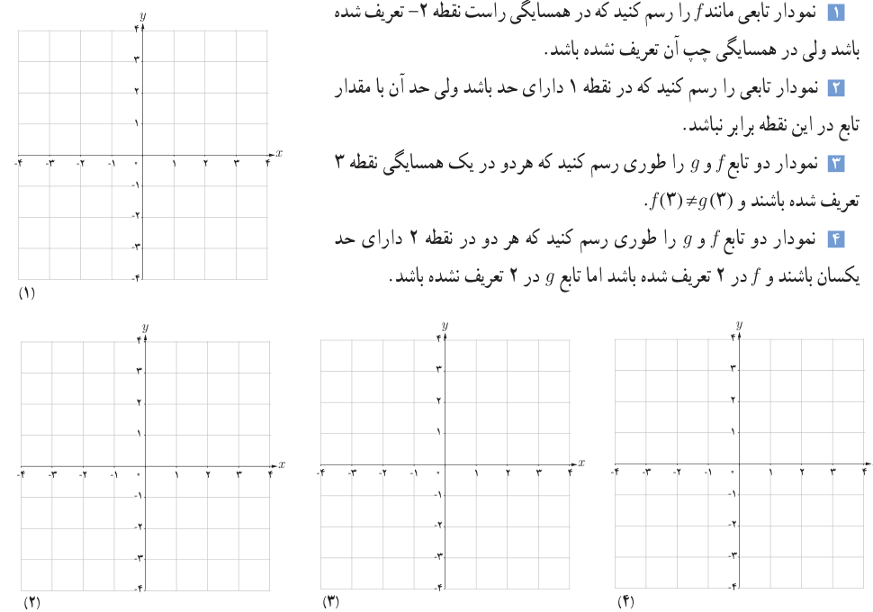

# فصل پنجم: حد و پیوستگی — ۱۱۹

## کار در کلاس

۱. یک همسایگی، یک همسایگی محذوف، یک همسایگی راست و یک همسایگی چپ برای ۳، مثال بزنید.

۲. آیا بازه $(2,3)$ یک همسایگی ۲ می‌باشد؟ چرا؟

## تعریف حد یک تابع

فرض کنیم تابع $f$ در یک همسایگی عدد $a$ (به جز احتمالاً در خود $a$) تعریف شده باشد. می‌گوییم «حد تابع $f$ وقتی $x$ به $a$ نزدیک می‌شود برابر عدد حقیقی $L$ است»، هرگاه مقادیر تابع $f$ را به هر اندازه دلخواه بتوان به $L$ نزدیک کرد، به شرط آنکه متغیر $x$ (با مقادیر مخالف $a$ از دو طرف) به قدر کافی به $a$، نزدیک شود.

در این صورت می‌نویسیم:

$$\lim_{x\to a}f(x)=L$$

عدد $L$ را حد تابع $f$ در $a$ می‌نامیم.

## کار در کلاس

۱. نمودار تابعی مانند $f$ را رسم کنید که در همسایگی راست نقطه ۲− تعریف شده باشد ولی در همسایگی چپ آن تعریف نشده باشد.

۲. نمودار تابعی را رسم کنید که در نقطه ۱ دارای حد باشد ولی حد آن با مقدار تابع در این نقطه برابر نباشد.

۳. نمودار دو تابع $f$ و $g$ را طوری رسم کنید که هر دو در یک همسایگی نقطه ۳ تعریف شده باشند و $f(3)\ne g(3)$.

۴. نمودار دو تابع $f$ و $g$ را طوری رسم کنید که هر دو در نقطه ۲ دارای حد یکسان باشند و $f$ در ۲ تعریف شده باشد اما تابع $g$ در ۲ تعریف نشده باشد.

