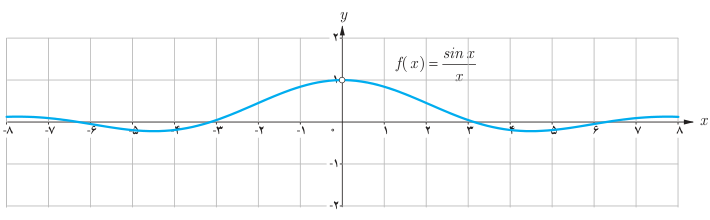
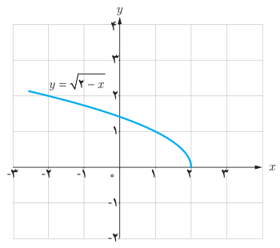
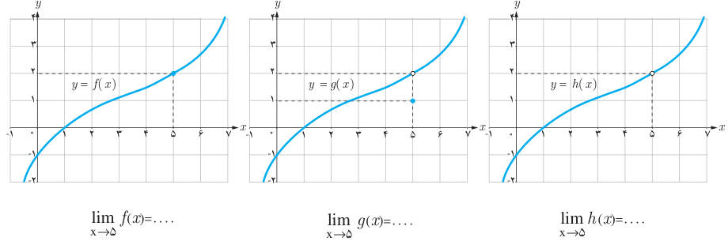

# ۱۲۰

۵. تابع $f$ با ضابطه $f(x)=\frac{\sin x}{x}$ در نقطه صفر تعریف نشده است. در جدول روبه‌رو برخی مقادیر این تابع در اطراف صفر داده شده است. با توجه به جدول و نمودار تابع $f$، مقدار $\lim_{x\to0}\frac{\sin x}{x}$ را به‌دست آورید. (محور $x$ها برحسب رادیان است).

| $x$ | $\frac{\sin x}{x}$ |
|---|---|
| $\pm1$ | ۰/۸۴۱۴۷۰۹۸ |
| $\pm0/5$ | ۰/۹۵۸۸۵۱۰۸ |
| $\pm0/4$ | ۰/۹۷۳۵۴۵۸۶ |
| $\pm0/3$ | ۰/۹۸۵۰۶۷۳۶ |
| $\pm0/2$ | ۰/۹۹۳۳۴۶۶۵ |
| $\pm0/1$ | ۰/۹۹۸۳۳۴۱۷ |
| $\pm0/05$ | ۰/۹۹۹۵۸۳۳۹ |
| $\pm0/01$ | ۰/۹۹۹۹۸۳۳۳ |
| $\pm0/005$ | ۰/۹۹۹۹۹۵۸۳ |
| $\pm0/001$ | ۰/۹۹۹۹۹۹۸۳ |

### مثال

آیا تابع $f(x)=\sqrt{2-x}$ در نقطه $x=2$ حد دارد؟ چرا؟

### حل

می‌دانیم دامنه تابع به صورت $D_f=(-\infty,2]$ می‌باشد. چون تابع $f$ در هیچ همسایگی محذوف ۲، تعریف نشده است (مقادیر بیشتر از ۲ در دامنه تابع نیست) بنابراین، تابع $f$ در نقطه $x=2$ حد ندارد.

## تمرین

۱. نمودار سه تابع $f$، $g$ و $h$ به‌صورت زیر داده شده است. مقدار حد این توابع را در نقطه $x=5$، مشخص کنید.

$$\lim_{x\to5}f(x)=\ldots\qquad\lim_{x\to5}g(x)=\ldots\qquad\lim_{x\to5}h(x)=\ldots$$
