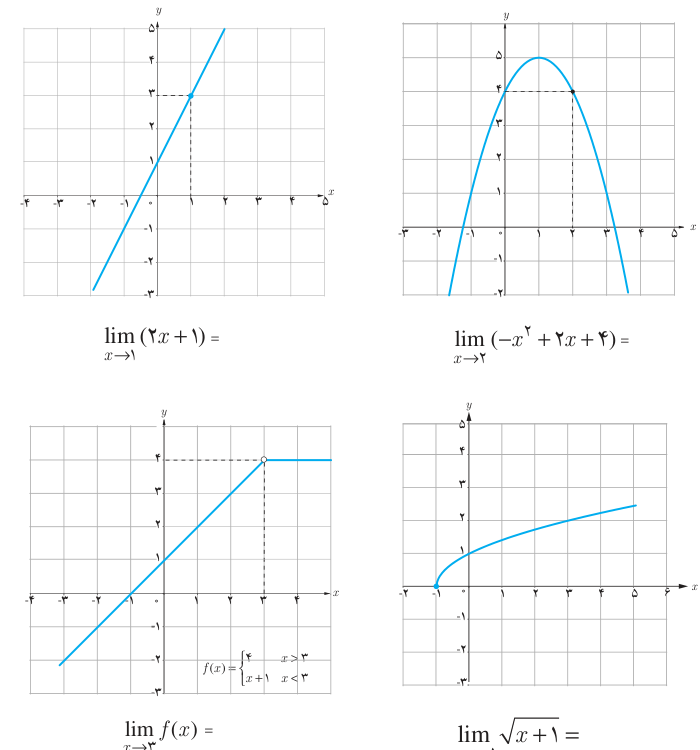

# فصل پنجم: حد و پیوستگی — ۱۲۱

۲. با استفاده از نمودار، مقدار حد توابع زیر را، در صورت وجود، در نقاط داده شده به‌دست آورید.

$$\lim_{x\to1}(2x+1)=\qquad\lim_{x\to2}(-x^2+2x+4)=$$

$$\lim_{x\to3}f(x)=\qquad\lim_{x\to-1}\sqrt{x+1}=$$

$$f(x)=\begin{cases}4&x>3\\x+1&x<3\end{cases}$$

۳. با تکمیل هر یک از جدول‌های زیر، مقدار حد هر تابع را در نقطه موردنظر بیابید.

الف) $\lim_{x\to0}(-3x+4)=\ldots$

| $x$ | −۱ | −۰/۹ | −۰/۱ | −۰/۰۱ | → | ۰ | ← | ۰/۰۰۱ | ۰/۰۱ | ۰/۱ | ۰/۵ | ۱ |
|---|---|---|---|---|---|---|---|---|---|---|---|---|
| $f(x)$ | … | … | … | … | → | ؟ | ← | … | … | … | … | … |

ب) $\lim_{x\to-1}f(x)=\ldots$، $f(x)=\begin{cases}x-4&x\ne-1\\3&x=-1\end{cases}$

| $x$ | −۲ | −۱/۵ | −۱/۱ | −۱/۰۱ | −۱/۰۰۱ | → | −۱ | ← | −۰/۹۹۹ | −۰/۹۹ | −۰/۹ | −۰/۸ |
|---|---|---|---|---|---|---|---|---|---|---|---|---|
| $f(x)$ | … | … | … | … | … | → | ؟ | ← | … | … | … | … |
