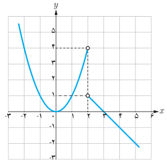
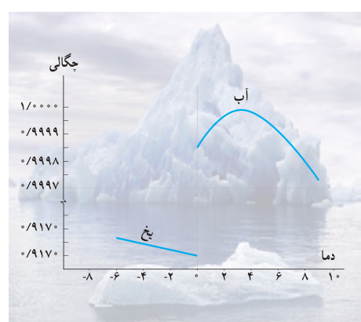

# درس ۲: حدهای یک‌طرفه (حد چپ و حد راست)

در درس قبل دیدیم که تابع $f(x)=\sqrt{2-x}$ در نقطه ۲ حد ندارد. (چون در هیچ همسایگی راست ۲ تعریف نشده است.) ولی با توجه به اینکه دامنه این تابع بازه $(-\infty,2]$ می‌باشد می‌توانیم رفتار تابع را در همسایگی چپ ۲ بررسی نماییم. گاهی لازم است، رفتار تابع را وقتی متغیر $x$ با مقادیر بزرگ‌تر از $a$ به $a$ نزدیک می‌شود یا وقتی متغیر $x$ با مقادیر کوچک‌تر از $a$ به $a$ نزدیک می‌شود بررسی و توصیف نماییم.

## فعالیت

نمودار تابع $f(x)=\begin{cases}-x+3&x>2\\x^2&x<2\end{cases}$ به‌صورت روبه‌رو است:

الف) اگر متغیر $x$ با مقادیر بزرگ‌تر از ۲ به ۲ نزدیک شود آن‌گاه مقادیر $f(x)$ به عدد … نزدیک می‌شوند.

ب) اگر $x$ با مقادیر کوچک‌تر از ۲ به ۲ نزدیک شود آن‌گاه مقادیر $f(x)$ به عدد … نزدیک می‌شوند.

پ) آیا تابع $f$ در نقطه $x=2$ حد دارد؟

## خواندنی

حتماً متوجه شده‌اید که یخ همیشه بر روی آب شناور است. توده یخ هرچقدر بزرگ باشد، باز هم در آب غرق نمی‌شود؛ مانند کوه‌های بزرگ یخ که بر روی آب دریاها و اقیانوس‌ها شناورند. آیا می‌دانید چرا یخ در آب غرق نمی‌شود؟

به‌طور کلی وقتی مایعی به شکل جامد درمی‌آید، منقبض می‌شود و مولکول‌هایش به هم نزدیک‌تر می‌شوند. به همین دلیل حجم ماده، کم می‌شود و چگالی آن افزایش می‌یابد. بنابراین مواد در حالت جامد سنگین‌تر از زمانی‌اند که به شکل مایع درآمده‌اند.

ولی آب مایعی است که خاصیت غیرعادی دارد. آب پس از انجماد به جای منقبض شدن، منبسط می‌شود؛ در نتیجه حجمش افزایش می‌یابد. تراکم یخ نه دهم آب است؛ به عبارت دیگر از نه لیتر آب ده لیتر یخ به‌دست می‌آید. به همین جهت وزن یخ، کمتر از آب هم‌حجمش است. به این ترتیب وقتی یخ درون آب قرار می‌گیرد، تنها نه دهم آن در آب فرو می‌رود و ۱/۱۰ دیگرش بر روی آب شناور می‌ماند.

نمودار چگالی آب و یخ بر حسب دما به‌صورت روبه‌رو است:

