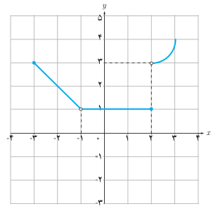
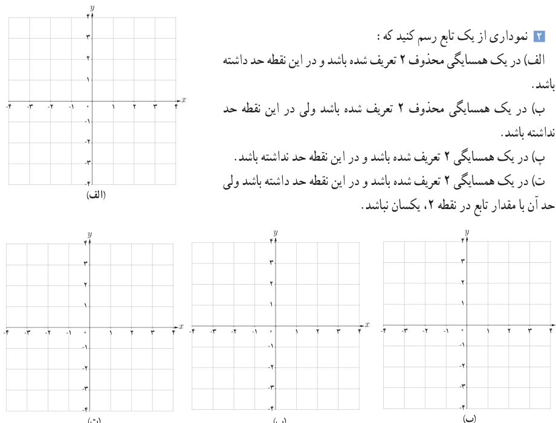

# فصل پنجم: حد و پیوستگی — ۱۲۵

## کار در کلاس

۱. با توجه به نمودار $f$، حدهای خواسته‌شده را، در صورت وجود، به‌دست آورید.

$$\lim_{x\to2^+}f(x)\ldots\qquad\lim_{x\to2^-}f(x)\ldots\qquad\lim_{x\to2}f(x)\ldots$$
$$\lim_{x\to-1^-}f(x)\ldots\qquad\lim_{x\to-1^+}f(x)\ldots\qquad\lim_{x\to-1}f(x)\ldots$$
$$\lim_{x\to-3^+}f(x)\ldots\qquad\lim_{x\to-3^-}f(x)\ldots\qquad\lim_{x\to-3}f(x)\ldots$$
$$\lim_{x\to1^-}f(x)\ldots\qquad\lim_{x\to1^+}f(x)\ldots\qquad\lim_{x\to1}f(x)\ldots$$

۲. نموداری از یک تابع رسم کنید که:

الف) در یک همسایگی محذوف ۲ تعریف شده باشد و در این نقطه حد داشته باشد.

ب) در یک همسایگی محذوف ۲ تعریف شده باشد ولی در این نقطه حد نداشته باشد.

پ) در یک همسایگی ۲ تعریف شده باشد و در این نقطه حد نداشته باشد.

ت) در یک همسایگی ۲ تعریف شده باشد و در این نقطه حد داشته باشد ولی حد آن با مقدار تابع در نقطه ۲، یکسان نباشد.

