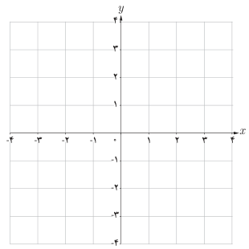

# ۱۲۶

## فعالیت

۱. نمودار تابع $f(x)=[x]$ را در فاصله $[-1,2]$ رسم کنید.

۲. اگر $x$ از طرف چپ به عدد ۱ نزدیک شود، آن‌گاه مقادیر $f(x)$ به عدد … نزدیک می‌شوند، بنابراین:

$$\lim_{x\to1^-}f(x)=\ldots$$

۳. حد راست تابع $f$ در نقطه $x=1$ را به‌دست آورید.

۴. آیا تابع $f$ در نقطه $x=1$ حد دارد؟ چرا؟

در فعالیت قبل مشاهده کردیم که در بازه $(1,2)$ که یک همسایگی راست ۱ می‌باشد نمودار تابع $f(x)=[x]$ بر نمودار تابع ثابت $g(x)=1$ منطبق است و داریم:

$$\lim_{x\to1^+}[x]=\lim_{x\to1^+}g(x)=1$$

به همین ترتیب، در $(0,1)$ که یک همسایگی چپ ۱ می‌باشد نمودار تابع $f(x)=[x]$ بر نمودار تابع ثابت $h(x)=0$ منطبق است و داریم:

$$\lim_{x\to1^-}[x]=\lim_{x\to1^-}h(x)=0$$

اگر دو تابع $f$ و $g$ در یک همسایگی راست نقطه‌ای مانند $a$ با هم برابر باشند و حد راست یکی از آنها در $a$ وجود داشته باشد آن‌گاه حد راست تابع دیگر نیز در $a$ وجود دارد و مقدار این دو حد با هم برابرند، یعنی:

اگر $\lim_{x\to a^+}f(x)=L$ آن‌گاه $\lim_{x\to a^+}g(x)=\lim_{x\to a^+}f(x)=L$.

به طریق مشابه، دو تابعی که در یک همسایگی چپ نقطه $a$ با هم برابرند مقدار حد چپ آنها در نقطه $a$ (در صورت وجود) یکسان است.

بنابراین، دو تابع که در یک همسایگی نقطه $a$ (به‌جز احتمالاً خود $a$) با هم برابر باشند مقدار حد آنها در نقطه $a$ (در صورت وجود) یکسان است.

### مثال

مقدار حد راست تابع $f(x)=\frac{[x]}x$ را در نقطه $x=0$ به‌دست آورید.

### حل

می‌دانیم روی بازه $(0,1)$ مقدار $[x]$ برابر صفر است، پس روی بازه $(0,1)$ تابع $f$ با تابع ثابت $g(x)=0$ برابر است بنابراین:

$$\lim_{x\to0^+}\frac{[x]}x=\lim_{x\to0^+}g(x)=0$$
