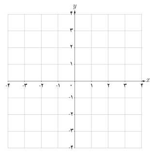
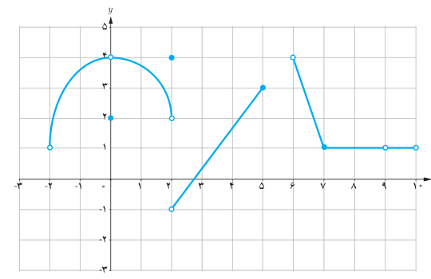

# فصل پنجم: حد و پیوستگی — ۱۲۷

## کار در کلاس

۱. تابع $f$ با ضابطه $f(x)=\frac{|x|}{x}$ را در نظر بگیرید:

الف) با استفاده از تعریف قدرمطلق، تابع $f$ را به‌صورت دوضابطه‌ای بنویسید.

ب) نمودار تابع $f$ را رسم کنید.

پ) با استفاده از نمودار $f$، حد چپ و حد راست تابع در صفر را به‌دست آورید.

ت) آیا تابع $f$ در نقطه صفر حد دارد؟ چرا؟

## تمرین

۱. نمودار تابع $f$ به‌صورت زیر است. حدهای زیر را در صورت وجود به‌دست آورید.

الف) $\lim_{x\to0}f(x)$　 ب) $\lim_{x\to2}f(x)$　 پ) $\lim_{x\to5}f(x)$

ت) $\lim_{x\to6^-}f(x)$　 ث) $\lim_{x\to-2^+}f(x)$　 ج) $\lim_{x\to8}f(x)$　 چ) $\lim_{x\to9}f(x)$
