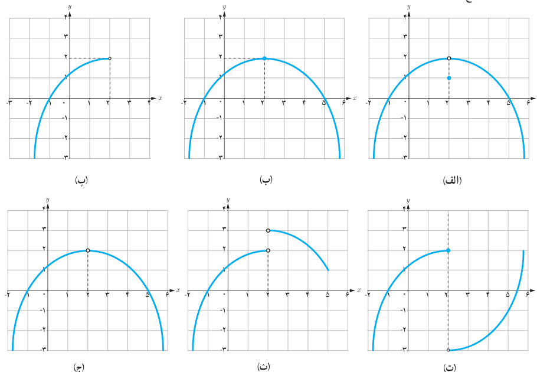

# ۱۲۸

۲. با رسم نمودار تابع $f(x)=\begin{cases}2x+1&x>0\\x^2+2x&x<0\end{cases}$ به سؤالات زیر پاسخ دهید:

الف) اگر $x$ از طرف چپ به عدد صفر نزدیک شود آن‌گاه مقادیر $f(x)$ به عدد … نزدیک می‌شوند، بنابراین:

$$\lim_{x\to0^-}f(x)=\ldots$$

ب) حد راست تابع $f$ در نقطه $x=0$ را به‌دست آورید.

پ) آیا تابع $f$ در نقطه $x=0$ حد دارد؟ چرا؟

۳. با توجه به نمودارهای توابع داده شده در زیر، هر کدام از گزاره‌های پایین صفحه در مورد چند تا از این توابع برقرار است؟ در هر مورد توابع را مشخص کنید.

- تابع در همسایگی محذوف ۲ تعریف شده و در این نقطه حد دارد.
- تابع در همسایگی ۲ تعریف شده و در این نقطه حد دارد ولی مقدار حد با مقدار تابع در این نقطه برابر نیست.
- تابع در همسایگی چپ ۲ تعریف شده و در این نقطه حد ندارد.
- تابع در همسایگی ۲ تعریف شده و در این نقطه حد دارد و حد آن برابر مقدار تابع در این نقطه است.
- تابع در نقطه ۲ تعریف نشده ولی در این نقطه حد دارد.
- تابع در همسایگی راست ۲ تعریف شده ولی در این نقطه حد ندارد.
