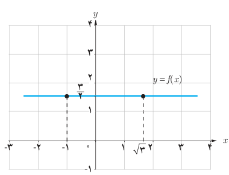
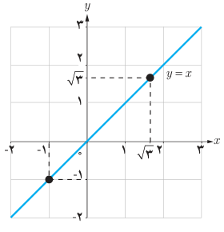

# درس ۳: قضایای حد

در بخش‌های قبل برای محاسبه حد توابع، با دو روش تکمیل جدول و رسم نمودار آشنا شدید. همان‌طور که مشاهده کردید تکمیل جدول زمان‌بر و رسم نمودار بعضی از توابع نیز مشکل است. در این بخش به بیان قضایایی درباره حد می‌پردازیم که با استفاده از آنها، حد بسیاری از توابع را می‌توان به‌آسانی محاسبه کرد.

## فعالیت

الف) فرض کنید $f$ تابع ثابت $\frac32$ باشد. با توجه به نمودار تابع، مقدار حدهای زیر را بیابید.

$$\lim_{x\to-1}f(x)=\ldots\qquad\lim_{x\to\sqrt3}f(x)=\ldots$$

ب) فرض کنید $g$ تابع همانی باشد، یعنی برای هر عدد حقیقی $x$ داشته باشیم $g(x)=x$. با توجه به نمودار، مقدار حدهای زیر را بیابید.

$$\lim_{x\to-1}g(x)=\ldots\qquad\lim_{x\to\sqrt3}g(x)=\ldots$$

## قضیه

الف) حد تابع ثابت $f(x)=c$ در هر عدد دلخواه $a$ برابر مقدار ثابت $c$ است. یعنی، $\lim_{x\to a}c=c$.

ب) حد تابع همانی $g(x)=x$ در هر عدد دلخواه $a$، برابر $a$ است. یعنی، $\lim_{x\to a}x=a$.
