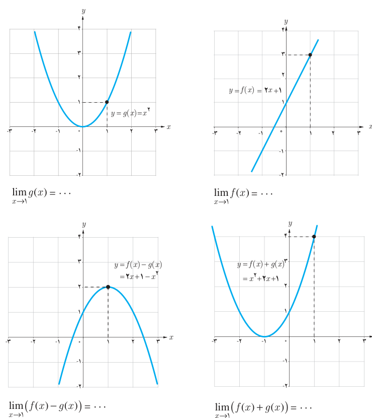

# فصل پنجم: حد و پیوستگی — ۱۳۱

## فعالیت

توابع $f(x)=2x+1$ و $g(x)=x^2$ را در نظر بگیرید.

الف) با توجه به نمودار توابع $f$، $g$، $f+g$ و $f-g$، مقدار حدهای خواسته شده را بیابید.

$$\lim_{x\to1}f(x)=\ldots\qquad\lim_{x\to1}g(x)=\ldots$$
$$\lim_{x\to1}(f(x)+g(x))=\ldots\qquad\lim_{x\to1}(f(x)-g(x))=\ldots$$

ب) با استفاده از قسمت (الف)، درستی این تساوی‌ها را بررسی کنید.

$$\lim_{x\to1}(f(x)+g(x))=\lim_{x\to1}f(x)+\lim_{x\to1}g(x)$$
$$\lim_{x\to1}(f(x)-g(x))=\lim_{x\to1}f(x)-\lim_{x\to1}g(x)$$
