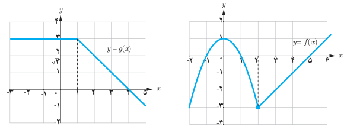

# فصل پنجم: حد و پیوستگی — ۱۳۳

## تذکر

قضیه قبل را می‌توان برای سه تابع و بیشتر نیز بیان کرد. یعنی، اگر $n$ یک عدد طبیعی و توابع $f_1,\ldots,f_n$ همگی در نقطه $x=a$ حد داشته باشند، آن‌گاه:

$$\lim_{x\to a}(f_1(x)+\cdots+f_n(x))=\lim_{x\to a}f_1(x)+\cdots+\lim_{x\to a}f_n(x)$$
$$\lim_{x\to a}(f_1(x)\times\cdots\times f_n(x))=\lim_{x\to a}f_1(x)\times\cdots\times\lim_{x\to a}f_n(x)$$

به‌ویژه، اگر تابع $f$ در نقطه $x=a$ حد داشته باشد آن‌گاه:

$$\lim_{x\to a}(f(x))^n=\left(\lim_{x\to a}f(x)\right)^n$$

که در حالت خاص، اگر تابع $f$ را تابع همانی $f(x)=x$ انتخاب کنیم، نتیجه می‌شود:

$$\lim_{x\to a}x^n=a^n$$

### مثال

دو تابع $f(x)=\begin{cases}1-x^2&x<2\\x-5&x\ge2\end{cases}$ و $g(x)=\begin{cases}3&x<1\\4-x&x\ge1\end{cases}$ را در نظر بگیرید. حد توابع $f+g$، $f-g$، $f.g$ و $\frac fg$ را در نقطه $x=2$ به‌دست آورید.

### حل

ابتدا حد دو تابع $f$ و $g$ را در نقطه $x=2$ محاسبه می‌کنیم. برای این منظور، نمودار دو تابع را رسم می‌کنیم.

با توجه به نمودارها داریم: $\lim_{x\to2}f(x)=-3$ و $\lim_{x\to2}g(x)=2$.

اکنون با استفاده از قضیه، به محاسبه حدهای مورد نظر می‌پردازیم:

$$\lim_{x\to2}(f(x)+g(x))=\lim_{x\to2}f(x)+\lim_{x\to2}g(x)=-3+2=-1$$
$$\lim_{x\to2}(f(x)-g(x))=\lim_{x\to2}f(x)-\lim_{x\to2}g(x)=-3-2=-5$$
$$\lim_{x\to2}(f(x)g(x))=\left(\lim_{x\to2}f(x)\right)\left(\lim_{x\to2}g(x)\right)=(-3)(2)=-6$$
$$\lim_{x\to2}\frac{f(x)}{g(x)}=\frac{\lim_{x\to2}f(x)}{\lim_{x\to2}g(x)}=\frac{-3}{2}$$
