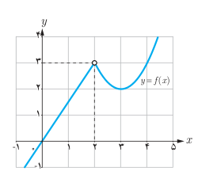

# ۱۳۴

### مثال

۱) $$\begin{aligned}
\lim_{x\to\sqrt2}(x^4+3x-1)&=\lim_{x\to\sqrt2}x^4+\lim_{x\to\sqrt2}3x-\lim_{x\to\sqrt2}1\\
&=(\lim_{x\to\sqrt2}x)^4+3\lim_{x\to\sqrt2}x-\lim_{x\to\sqrt2}1\\
&=(\sqrt2)^4+3(\sqrt2)-1=4+3\sqrt2-1=3+3\sqrt2
\end{aligned}$$

۲) $\lim_{x\to3}x|x|=(\lim_{x\to3}x)\times(\lim_{x\to3}|x|)=3\times|3|=9$

۳) $\lim_{x\to\frac12}\frac{4x^2+7}{1-x}=\frac{\lim_{x\to\frac12}(4x^2+7)}{\lim_{x\to\frac12}(1-x)}=\frac{4(\lim_{x\to\frac12}x)^2+7}{1-\lim_{x\to\frac12}x}=\frac{4(\frac12)^2+7}{1-\frac12}=16$

## قضیه

هر چندجمله‌ای مانند $p(x)=b_nx^n+b_{n-1}x^{n-1}+\cdots+b_1x+b_0$ در هر نقطه دلخواه $a$ حد دارد و مقدار حد با مقدار چندجمله‌ای در نقطه $a$ برابر است. یعنی:

$$\lim_{x\to a}(b_nx^n+b_{n-1}x^{n-1}+\cdots+b_0)=b_na^n+b_{n-1}a^{n-1}+\cdots+b_0$$

## کار در کلاس

الف) مقدار حدهای زیر را بیابید.

۱) $\lim_{x\to-1}x^4$　 ۲) $\lim_{x\to1}(5x^3-6|x|+1)$

۳) $\lim_{x\to2}\frac{x^2+4x+4}{4x^3-7x+1}$　 ۴) $\lim_{x\to\frac12}\frac{x-[x]}{1-x}$

ب) نمودار تابع $f$ در شکل روبه‌رو رسم شده است. مقدار $\lim_{x\to2}xf(x)$ را بیابید.

