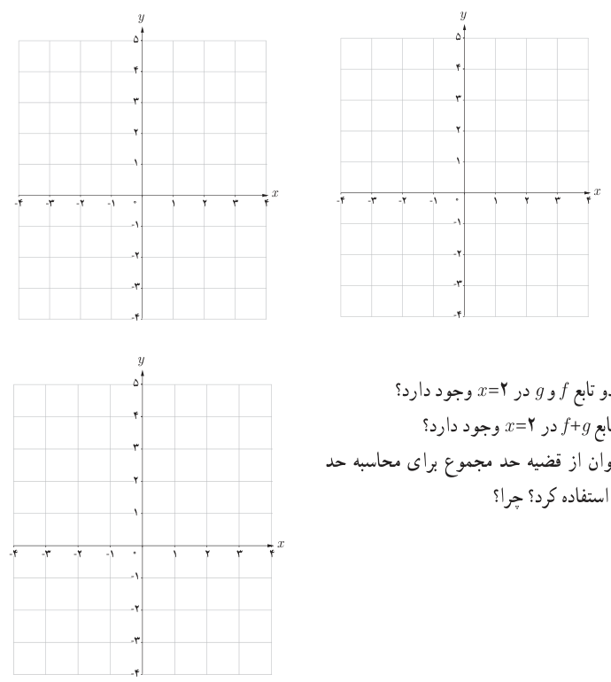

# فصل پنجم: حد و پیوستگی — ۱۳۵

## فعالیت

دو تابع $f(x)=\begin{cases}4&x\le2\\3&x>2\end{cases}$ و $g(x)=\begin{cases}-2&x\le2\\-1&x>2\end{cases}$ را در نظر بگیرید.

الف) ضابطه تابع $f+g$ را بیابید.

ب) نمودار توابع $f$، $g$ و $f+g$ را رسم کنید.

پ) آیا حد دو تابع $f$ و $g$ در $x=2$ وجود دارد؟

ت) آیا حد تابع $f+g$ در $x=2$ وجود دارد؟

ث) آیا می‌توان از قضیه حد مجموع برای محاسبه حد $f+g$ در $x=2$ استفاده کرد؟ چرا؟

برای استفاده از قضیه حد مجموع، حد تفاضل و …، ابتدا باید توجه کنیم که حد توابع $f$ و $g$ در نقطه $x=a$ موجود باشند.
