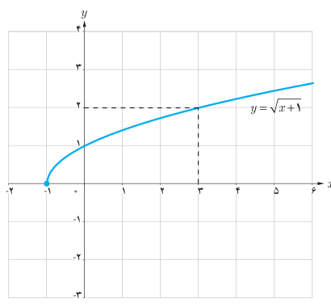

# ۱۳۶

## کار در کلاس

فرض کنید توابع $f$ و $g$ در یک همسایگی محذوف نقطه $a$ تعریف شده‌اند.

الف) اگر $\lim_{x\to a}(f(x)+g(x))$ موجود باشد، آیا می‌توان نتیجه گرفت $\lim_{x\to a}f(x)$ و $\lim_{x\to a}g(x)$ وجود دارند؟ چرا؟

ب) ثابت کنید اگر $\lim_{x\to a}(f(x)+g(x))$ و $\lim_{x\to a}f(x)$ موجود باشند، آن‌گاه $\lim_{x\to a}g(x)$ نیز وجود دارد.

## فعالیت

در شکل روبه‌رو نمودار تابع $f(x)=\sqrt{x+1}$ رسم شده است.

الف) با توجه به نمودار، مقدار حد $\lim_{x\to3}\sqrt{x+1}$ را بیابید.

ب) آیا تساوی $\lim_{x\to3}\sqrt{x+1}=\sqrt{\lim_{x\to3}(x+1)}$ برقرار است؟

## قضیه

فرض کنید تابع $f$ در نقطه $a$ حد دارد. اگر تابع $f$ در یک همسایگی محذوف $a$ نامنفی باشد آن‌گاه داریم:

$$\lim_{x\to a}\sqrt{f(x)}=\sqrt{\lim_{x\to a}f(x)}$$

به‌طور کلی، برای هر عدد طبیعی $n$، اگر $\sqrt[n]{f(x)}$ در یک همسایگی $a$ تعریف شده باشد، آن‌گاه داریم:

$$\lim_{x\to a}\sqrt[n]{f(x)}=\sqrt[n]{\lim_{x\to a}f(x)}$$

### مثال

۱) $\lim_{x\to a}\sqrt[n]x=\sqrt[n]a$ (برای $n$های زوج $a$ باید مثبت باشد)

۲) $\lim_{x\to1}\frac{\sqrt{2x-1}}{3x-4}=\frac{\lim_{x\to1}\sqrt{2x-1}}{\lim_{x\to1}(3x-4)}=\frac{\sqrt{\lim_{x\to1}(2x-1)}}{\lim_{x\to1}(3x-4)}=\frac{\sqrt{2(1)-1}}{3(1)-4}=-1$
