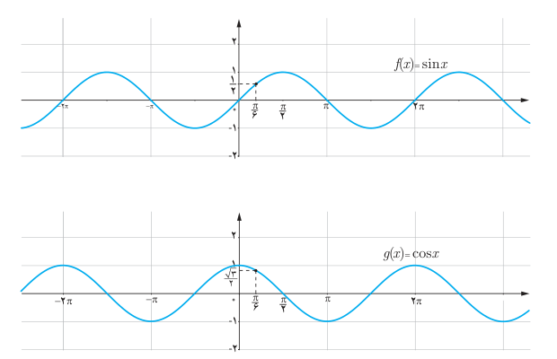

# فصل پنجم: حد و پیوستگی — ۱۳۷

## حد توابع مثلثاتی

### فعالیت

نمودارهای توابع $f(x)=\sin x$ و $g(x)=\cos x$ در زیر رسم شده‌اند.

الف) مقدار حدهای زیر را بیابید.

۱) $\lim_{x\to\frac\pi6}\sin x=\ldots$　 ۲) $\lim_{x\to\pi}\sin x=\ldots$

۳) $\lim_{x\to\frac\pi6}\cos x=\ldots$　 ۴) $\lim_{x\to\pi}\cos x=\ldots$

ب) آیا مقدار حد تابع $f(x)=\sin x$ در $\frac\pi6$ با مقدار $\sin(\frac\pi6)$ برابر است؟

پ) آیا مقدار حد تابع $g(x)=\cos x$ در $\frac\pi6$ با مقدار $\cos(\frac\pi6)$ برابر است؟

## قضیه

برای هر عدد حقیقی $a$،

$$\lim_{x\to a}\sin x=\sin a\qquad\text{و}\qquad\lim_{x\to a}\cos x=\cos a$$

### مثال

$$\lim_{x\to\frac\pi6}(2\cos^2x-\sin x)=2\cos^2(\tfrac\pi6)-\sin(\tfrac\pi6)=2(\tfrac{\sqrt3}2)^2-\tfrac12=1$$
