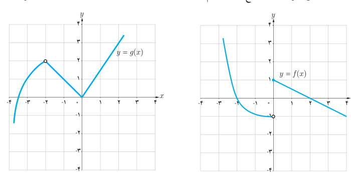

# ۱۴۰

۵. توابع زیر را در نظر بگیرید.

$$y=3x+2,\quad y=x^2-1,\quad y=[x]-1,\quad y=\begin{cases}-2&x<1\\2&x>1\end{cases}$$

الف) مقدار حد هر یک از توابع فوق در $x=1$ را (در صورت وجود) بیابید.

ب) با انتخاب توابع $f$ و $g$ از بین چهار تابع فوق، جدول زیر را کامل کنید.

| شرط | $f(x)$ | $g(x)$ | حاصل |
|---|---|---|---|
| هر سه تابع $f$، $g$ و $f+g$ در ۱ حد دارند. | … | … | $f(x)+g(x)=\ldots$ |
| تابع $f.g$ در ۱ حد دارد اما تابع $f$ در ۱ حد ندارد. | … | … | $f(x)g(x)=\ldots$ |
| توابع $f$ و $g$ در ۱ حد راست دارند اما تابع $\frac fg$ در ۱ حد راست ندارد. | … | … | $\frac{f(x)}{g(x)}=\ldots$ |
| تابع $f^2$ در ۱ حد دارد اما تابع $f$ در ۱ حد ندارد. | … | | $f^2(x)=\ldots$ |
| تابع $f$ در ۱ حد دارد اما تابع $\sqrt f$ در ۱ حد ندارد. | … | | $\sqrt{f(x)}=\ldots$ |

۶. اگر حد تابع $f$ در $a$ موجود باشد اما تابع $g$ در $a$ حد نداشته باشد در مورد وجود حد تابع $f+g$ در $a$ چه می‌توان گفت؟

۷. مقدار $b$ را طوری تعیین کنید که تابع زیر در $x=-1$ حد داشته باشد:

$$f(x)=\begin{cases}\frac{x^2+[x]}{|x|}&x<-1\\3x+b&x>-1\end{cases}$$

۸. در شکل زیر نمودار توابع $f$ و $g$ رسم شده‌اند. با استفاده از نمودارها، مقدار حدهای زیر را بیابید.

$$\lim_{x\to-2}(2g(x)-f(x))\qquad\lim_{x\to0}\frac{g(x)}{f(x)}\qquad\lim_{x\to-3}-3\sqrt{g(x)}\qquad\lim_{x\to2}\sqrt[3]{8g(x)}$$
