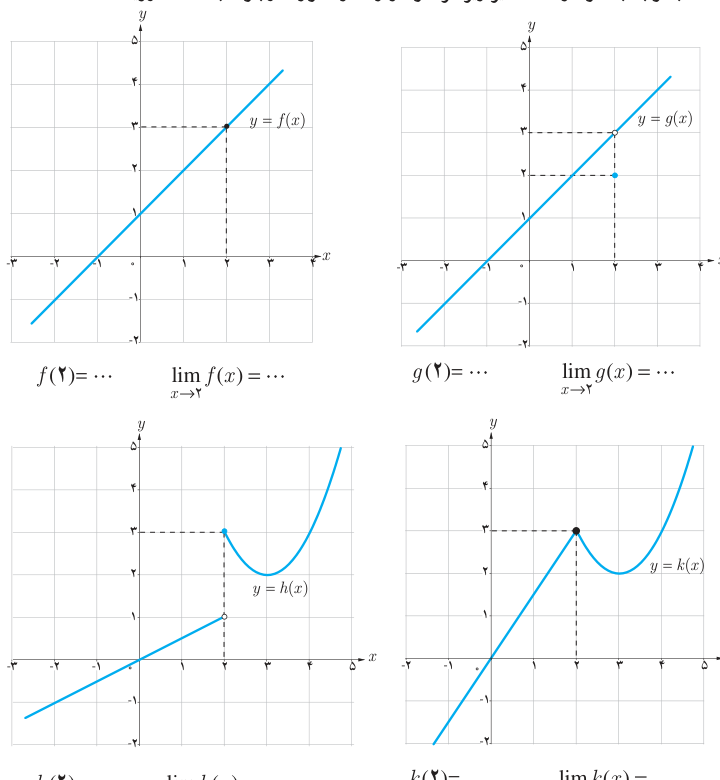

# درس ۵: پیوستگی

## فعالیت

الف) با توجه به نمودارها، مقادیر زیر هر نمودار را (در صورت وجود) به‌دست آورید.

$$f(2)=\ldots\quad\lim_{x\to2}f(x)=\ldots\qquad g(2)=\ldots\quad\lim_{x\to2}g(x)=\ldots$$
$$h(2)=\ldots\quad\lim_{x\to2}h(x)=\ldots\qquad k(2)=\ldots\quad\lim_{x\to2}k(x)=\ldots$$

ب) برای کدام‌یک از توابع، حد تابع در ۲ با مقدار تابع در ۲ برابر است؟

پ) در نمودار کدام‌یک از توابع، در نقطه‌ای به طول ۲، گسستگی وجود ندارد؟

همان‌طور که در شکل‌های فوق مشاهده می‌کنید نمودار تابع $f$ (و همچنین تابع $k$) در نقطه‌ای به طول ۲، هیچ گسستگی ندارد. در این حالت اصطلاحاً گوییم «تابع $f$ (و همچنین تابع $k$) در نقطه $x=2$ پیوسته است».
