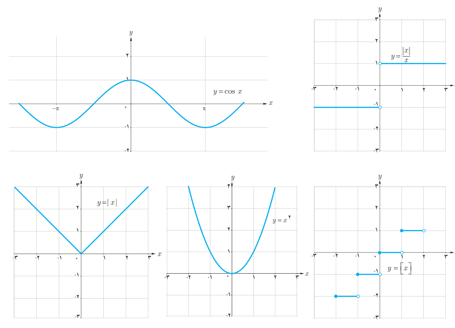

# ۱۴۶

## تعریف پیوستگی

گوییم تابع $f$ در نقطه $x=a$ پیوسته است هرگاه $\lim_{x\to a}f(x)=f(a)$.

بنابراین، برای پیوسته بودن تابع $f$ در نقطه $a$، باید شرایط زیر برقرار باشند:

الف) تابع $f$ در $a$ تعریف شده باشد.

ب) حد تابع $f$ در $a$ موجود باشد.

پ) مقدار حد تابع $f$ در $a$ با مقدار $f(a)$ برابر باشد.

هنگامی که تابع $f$ در نقطه $x=a$ پیوسته نیست، گوییم $f$ در $x=a$ ناپیوسته است.

### مثال

در بخش‌های قبل دیدیم که در هر نقطه $a$، $\lim_{x\to a}\sin x=\sin a$ و $\lim_{x\to a}\sqrt[3]x=\sqrt[3]a$. پس توابع $y=\sin x$ و $y=\sqrt[3]x$ در هر عدد $a$، پیوسته‌اند.

همچنین توابع $y=\cos x$، $y=|x|$ و $y=x^2$ و نیز چندجمله‌ای‌ها در هر عدد حقیقی $a$ پیوسته‌اند. اما توابع $y=\frac{|x|}{x}$ و $y=[x]$ این‌چنین نیستند. این مطلب را از روی نمودار این توابع نیز می‌توان تشخیص داد.

