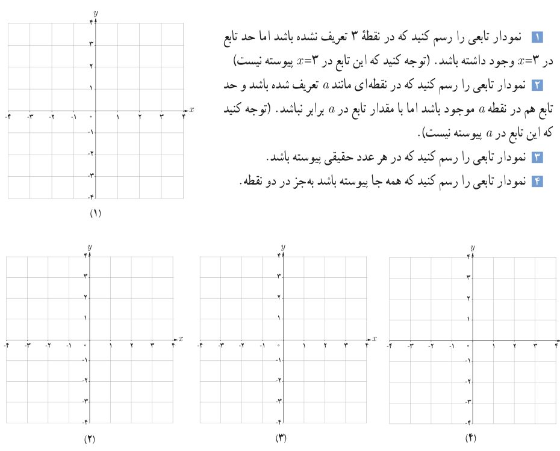

# فصل پنجم: حد و پیوستگی — ۱۴۷

### مثال

توابع $f(x)=\frac{x^2-9}{x-3}$ و $g(x)=\begin{cases}\frac{x^2-9}{x-3}&x\ne3\\6&x=3\end{cases}$ داده شده‌اند. درباره پیوستگی $f$ و $g$ در نقطه ۳ بحث کنید.

### حل

از آنجایی که $f$ در ۳ تعریف نشده است، پس تابع $f$ در ۳ پیوسته نیست. در مورد تابع $g$ داریم:

$$\lim_{x\to3}g(x)=\lim_{x\to3}\frac{x^2-9}{x-3}=\lim_{x\to3}\frac{(x-3)(x+3)}{x-3}=6=g(3)$$

پس تابع $g$ در ۳ پیوسته است.

## کار در کلاس

۱. نمودار تابعی را رسم کنید که در نقطه ۳ تعریف نشده باشد اما حد تابع در $x=3$ وجود داشته باشد. (توجه کنید که این تابع در $x=3$ پیوسته نیست)

۲. نمودار تابعی را رسم کنید که در نقطه‌ای مانند $a$ تعریف شده باشد و حد تابع هم در نقطه $a$ موجود باشد اما با مقدار تابع در $a$ برابر نباشد. (توجه کنید که این تابع در $a$ پیوسته نیست).

۳. نمودار تابعی را رسم کنید که در هر عدد حقیقی پیوسته باشد.

۴. نمودار تابعی را رسم کنید که همه جا پیوسته باشد به‌جز در دو نقطه.

