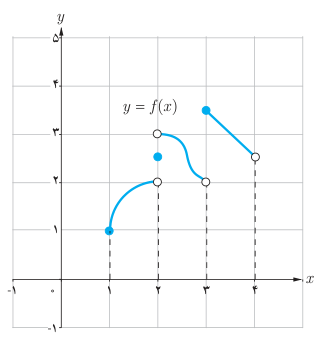

# ۱۴۸

## فعالیت

نمودار تابع $f$ به‌صورت روبه‌رو رسم شده است.

الف) تابع $f$ در کدام‌یک از نقاط مجموعه $\{1,2,2/5,3,4\}$ ناپیوسته است.

ب) آیا تساوی $\lim_{x\to3^+}f(x)=f(3)$ برقرار است؟

پ) آیا تساوی $\lim_{x\to3^-}f(x)=f(3)$ برقرار است؟

ت) در کدام نقطه $a$ از مجموعه $\{1,2,2/5,3,4\}$ تساوی $\lim_{x\to a^+}f(x)=f(a)$ برقرار است؟

## تعریف

گوییم تابع $f$ در $a$ از راست پیوسته است (یا پیوستگی راست دارد) هرگاه: $\lim_{x\to a^+}f(x)=f(a)$.

گوییم تابع $f$ در $a$ از چپ پیوسته است (یا پیوستگی چپ دارد) هرگاه: $\lim_{x\to a^-}f(x)=f(a)$.

بنابراین، هرگاه تابع $f$ در یک همسایگی (دوطرفه) $a$ تعریف شده باشد:

$f$ در $a$ پیوسته است اگر و تنها اگر $f$ در $a$ هم از راست و هم از چپ پیوسته باشد.

### مثال

تابع $f(x)=\begin{cases}3x^2+x&x<0\\2&x=0\\2\cos x-\sin x&x>0\end{cases}$ داده شده است. پیوستگی تابع $f$ در صفر را بررسی کنید.

### حل

داریم $f(0)=2$. همچنین

$$\lim_{x\to0^-}f(x)=\lim_{x\to0^-}(3x^2+x)=0\ne f(0)$$
$$\lim_{x\to0^+}f(x)=\lim_{x\to0^+}(2\cos x-\sin x)=2\cos(0)-\sin(0)=2=f(0)$$

بنابراین $f$ در صفر پیوسته نیست اما در صفر پیوستگی راست دارد.
