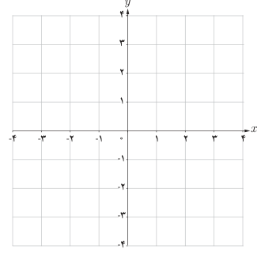
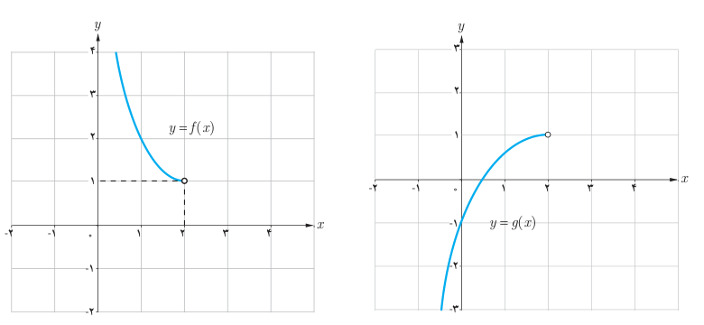

# فصل پنجم: حد و پیوستگی — ۱۴۹

## کار در کلاس

الف) با رسم نمودار تابع $f(x)=[x]$ مشخص کنید که در کدام‌یک از نقاط مجموعه $\{0,\frac12,2\}$،

۱. تابع $f$ پیوسته است.

۲. تابع $f$ پیوستگی راست دارد.

۳. تابع $f$ پیوستگی چپ دارد.

ب) در شکل‌های زیر نمودار دو تابع $f$ و $g$ در طرف چپ نقطه ۲ رسم شده‌اند. در نقطه $x=2$ و در طرف راست نقطه ۲، نمودارها را طوری تکمیل نمایید که:

۱. تابع $f$ در نقطه ۲ پیوستگی راست داشته باشد، اما در ۲ پیوسته نباشد.

۲. تابع $g$ در نقطه ۲ پیوسته باشد.

## تعریف (پیوستگی بر بازه)

تابع $f$ را بر بازه باز $(a,b)$ پیوسته گوییم هرگاه در هر نقطه $(a,b)$ پیوسته باشد.

تابع $f$ را بر بازه بسته $[a,b]$ پیوسته گوییم هرگاه تابع $f$ در هر نقطه $(a,b)$ پیوسته باشد و در $a$ از راست پیوسته و در $b$ از چپ پیوسته باشد.
