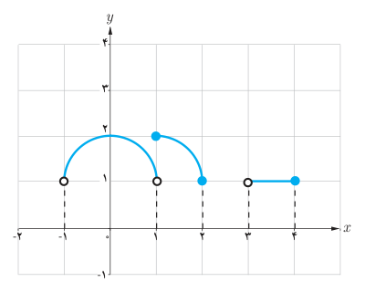

# ۱۵۰

## کار در کلاس

پیوستگی روی بازه‌های $[a,b)$ و $(a,b]$ را به‌طور مشابه تعریف کنید.

### مثال

۱) تابع $f(x)=\sqrt x$ بر بازه $[0,2]$ پیوسته است.

۲) تابع $f(x)=[x]$ بر بازه $(0,1)$ پیوسته است، اما بر بازه بسته $[0,1]$ پیوسته نیست.

## کار در کلاس

در شکل روبه‌رو نمودار تابع $f$ رسم شده است. کدام‌یک از عبارات زیر درست و کدام‌یک نادرست هستند؟

الف) تابع $f$ بر بازه $[1,2]$ پیوسته است.

ب) تابع $f$ بر بازه $[3,4]$ پیوسته است.

پ) تابع $f$ بر بازه $[0,2]$ پیوسته است.

نقش رستم – استان فارس
