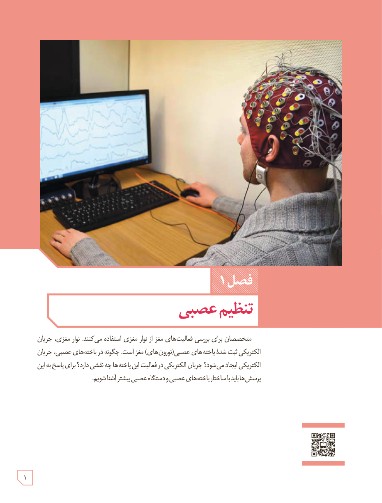

# فصل ۱: تنظیم عصبی

متخصصان برای بررسی فعالیت‌های مغز از نوار مغزی استفاده می‌کنند. نوار مغزی، جریان الکتریکی ثبت شدۀ یاخته‌های عصبی (نورون‌های) مغز است. چگونه در یاخته‌های عصبی، جریان الکتریکی ایجاد می‌شود؟ جریان الکتریکی در فعالیت این یاخته‌ها چه نقشی دارد؟ برای پاسخ به این پرسش‌ها باید با ساختار یاخته‌های عصبی و دستگاه عصبی بیشتر آشنا شویم.

۱
