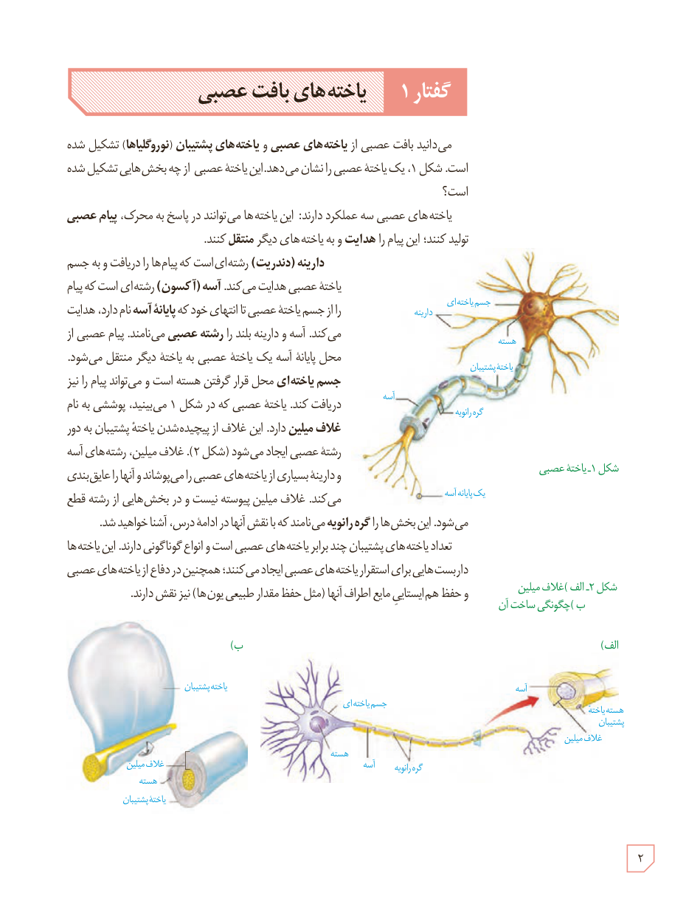

# گفتار ۱: یاخته‌های بافت عصبی

می‌دانید بافت عصبی از **یاخته‌های عصبی** و **یاخته‌های پشتیبان (نوروگلیاها)** تشکیل شده است. شکل ۱، یک یاختۀ عصبی را نشان می‌دهد. این یاختۀ عصبی از چه بخش‌هایی تشکیل شده است؟

یاخته‌های عصبی سه عملکرد دارند: این یاخته‌ها می‌توانند در پاسخ به محرک، **پیام عصبی** تولید کنند؛ این پیام را **هدایت** و به یاخته‌های دیگر **منتقل** کنند.

**دارینه (دندریت)** رشته‌ای است که پیام‌ها را دریافت و به جسم یاختۀ عصبی هدایت می‌کند. **آسه (آکسون)** رشته‌ای است که پیام را از جسم یاختۀ عصبی تا انتهای خود که **پایانۀ آسه** نام دارد، هدایت می‌کند. آسه و دارینۀ بلند را **رشتۀ عصبی** می‌نامند. پیام عصبی از محل پایانۀ آسه یک یاختۀ عصبی به یاختۀ دیگر منتقل می‌شود. **جسم یاخته‌ای** محل قرار گرفتن هسته است و می‌تواند پیام را نیز دریافت کند. یاخته‌ای که در شکل ۱ می‌بینید، پوششی به نام **غلاف میلین** دارد. این غلاف از پیچیده‌شدن یاختۀ پشتیبان به دور رشتۀ عصبی ایجاد می‌شود (شکل ۲). غلاف میلین، رشته‌های آسه و دارینۀ بسیاری از یاخته‌های عصبی را می‌پوشاند و آنها را عایق‌بندی می‌کند. غلاف میلین پیوسته نیست و در بخش‌هایی از رشته قطع می‌شود. این بخش‌ها را **گره رانویه** می‌نامند که با نقش آنها در ادامۀ درس، آشنا خواهید شد.

تعداد یاخته‌های پشتیبان چند برابر یاخته‌های عصبی است و انواع گوناگونی دارند. این یاخته‌ها داربست‌هایی برای استقرار یاخته‌های عصبی ایجاد می‌کنند؛ همچنین در دفاع از یاخته‌های عصبی و حفظ هم‌ایستایی مایع اطراف آنها (مثل حفظ مقدار طبیعی یون‌ها) نیز نقش دارند.

شکل ۱ـ یاختۀ عصبی  
شکل ۲ـ الف) غلاف میلین، ب) چگونگی ساخت آن

۲
