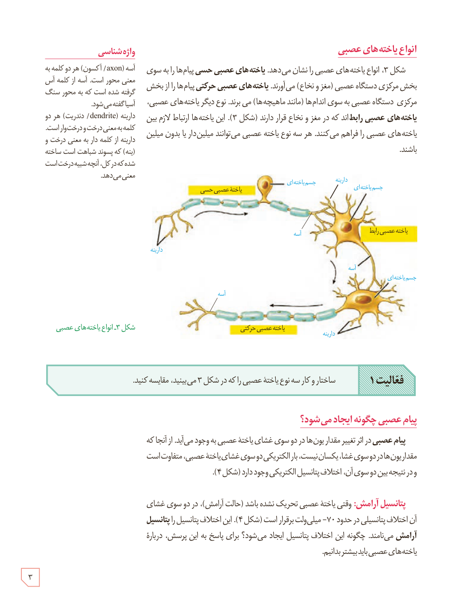

# انواع یاخته‌های عصبی

شکل ۳، انواع یاخته‌های عصبی را نشان می‌دهد. **یاخته‌های عصبی حسی** پیام‌ها را به سوی بخش مرکزی دستگاه عصبی (مغز و نخاع) می‌آورند. **یاخته‌های عصبی حرکتی** پیام‌ها را از بخش مرکزی دستگاه عصبی به سوی اندام‌ها (مانند ماهیچه‌ها) می‌برند. نوع دیگر یاخته‌های عصبی، **یاخته‌های عصبی رابط**اند که در مغز و نخاع قرار دارند (شکل ۳). این یاخته‌ها ارتباط لازم بین یاخته‌های عصبی را فراهم می‌کنند. هر سه نوع یاختۀ عصبی می‌توانند میلین‌دار یا بدون میلین باشند.

شکل ۳ـ انواع یاخته‌های عصبی

**فعالیت ۱:** ساختار و کار سه نوع یاختۀ عصبی را که در شکل ۳ می‌بینید، مقایسه کنید.

## پیام عصبی چگونه ایجاد می‌شود؟

**پیام عصبی** در اثر تغییر مقدار یون‌ها در دو سوی غشای یاختۀ عصبی به وجود می‌آید. از آنجا که مقدار یون‌ها در دو سوی غشا، یکسان نیست، بار الکتریکی دو سوی غشای یاختۀ عصبی، متفاوت است و در نتیجه بین دو سوی آن، اختلاف پتانسیل الکتریکی وجود دارد (شکل ۴).

**پتانسیل آرامش:** وقتی یاختۀ عصبی تحریک نشده باشد (حالت آرامش)، در دو سوی غشای آن اختلاف پتانسیلی در حدود ۷۰− میلی‌ولت برقرار است (شکل ۴). این اختلاف پتانسیل را **پتانسیل آرامش** می‌نامند. چگونه این اختلاف پتانسیل ایجاد می‌شود؟ برای پاسخ به این پرسش، درباره یاخته‌های عصبی باید بیشتر بدانیم.

### واژه‌شناسی

آسه (axon/ آکسون) هر دو کلمه به معنی محور است. آسه از کلمه آس گرفته شده است که به محور سنگ آسیا گفته می‌شود.

دارینه (dendrite/ دندریت) هر دو کلمه به معنی درخت و درخت‌وار است. دارینه از کلمه دار به معنی درخت و (ینه) که پسوند شباهت است ساخته شده که در کل، آنچه شبیه درخت است معنی می‌دهد.

۳

