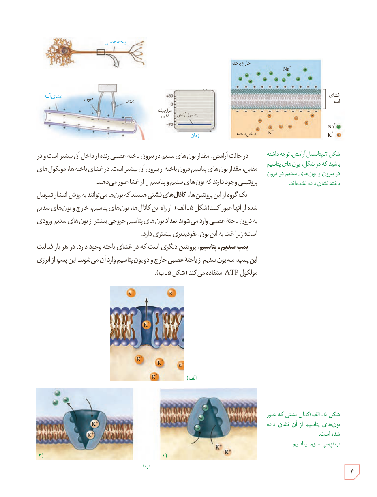

شکل ۴ـ پتانسیل آرامش. توجه داشته باشید که در شکل، یون‌های پتاسیم در بیرون و یون‌های سدیم در درون یاخته نشان داده نشده‌اند.

در حالت آرامش، مقدار یون‌های سدیم در بیرون یاختۀ عصبی زنده از داخل آن بیشتر است و در مقابل، مقدار یون‌های پتاسیم درون یاخته از بیرون آن بیشتر است. در غشای یاخته‌ها، مولکول‌های پروتئینی وجود دارند که یون‌های سدیم و پتاسیم را از غشا عبور می‌دهند.

یک گروه از این پروتئین‌ها، **کانال‌های نشتی** هستند که یون‌ها می‌توانند به روش انتشار تسهیل شده از آنها عبور کنند (شکل ۵ـ الف). از راه این کانال‌ها، یون‌های پتاسیم، خارج و یون‌های سدیم به درون یاختۀ عصبی وارد می‌شوند. تعداد یون‌های پتاسیم خروجی بیشتر از یون‌های سدیم ورودی است؛ زیرا غشا به این یون، نفوذپذیری بیشتری دارد.

**پمپ سدیم ـ پتاسیم**، پروتئین دیگری است که در غشای یاخته وجود دارد. در هر بار فعالیت این پمپ، سه یون سدیم از یاختۀ عصبی خارج و دو یون پتاسیم وارد آن می‌شوند. این پمپ از انرژی مولکول ATP استفاده می‌کند (شکل ۵ـ ب).

شکل ۵ـ الف) کانال نشتی که عبور یون‌های پتاسیم از آن نشان داده شده است. ب) پمپ سدیم ـ پتاسیم

۴

