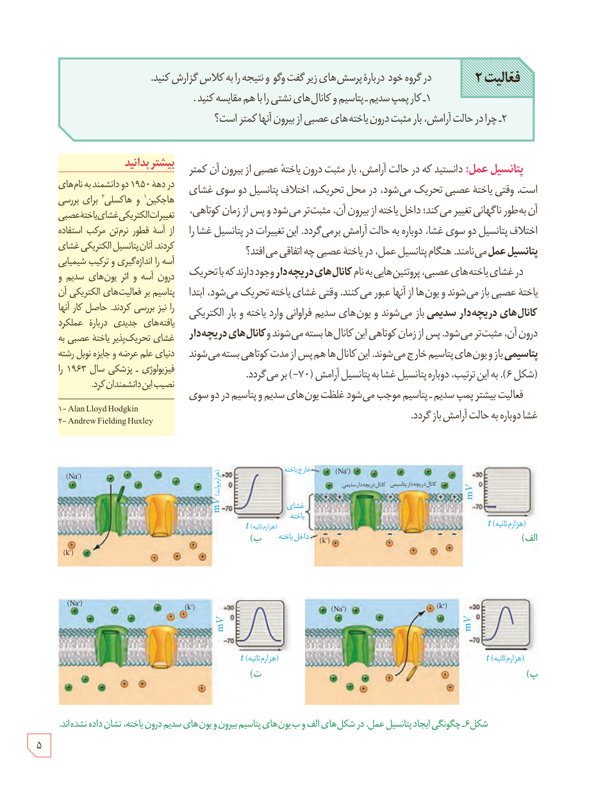

**فعالیت ۲**

در گروه خود درباره پرسش‌های زیر گفت‌وگو و نتیجه را به کلاس گزارش کنید.

۱- کار پمپ سدیم ـ پتاسیم و کانال‌های نشتی را با هم مقایسه کنید.
۲- چرا در حالت آرامش، بار مثبت درون یاخته‌های عصبی از بیرون آنها کمتر است؟

**پتانسیل عمل:** دانستید که در حالت آرامش، بار مثبت درون یاختۀ عصبی از بیرون آن کمتر است. وقتی یاختۀ عصبی تحریک می‌شود، در محل تحریک، اختلاف پتانسیل دو سوی غشای آن به‌طور ناگهانی تغییر می‌کند؛ داخل یاخته از بیرون آن، مثبت‌تر می‌شود و پس از زمان کوتاهی، اختلاف پتانسیل دو سوی غشا، دوباره به حالت آرامش برمی‌گردد. این تغییرات در پتانسیل غشا را **پتانسیل عمل** می‌نامند. هنگام پتانسیل عمل، در یاختۀ عصبی چه اتفاقی می‌افتد؟

در غشای یاخته‌های عصبی، پروتئین‌هایی به نام **کانال‌های دریچه‌دار** وجود دارند که با تحریک یاختۀ عصبی باز می‌شوند و یون‌ها از آنها عبور می‌کنند. وقتی غشای یاخته تحریک می‌شود، ابتدا **کانال‌های دریچه‌دار سدیمی** باز می‌شوند و یون‌های سدیم فراوانی وارد یاخته و بار الکتریکی درون آن، مثبت‌تر می‌شود. پس از زمان کوتاهی این کانال‌ها بسته می‌شوند و **کانال‌های دریچه‌دار پتاسیمی** باز و یون‌های پتاسیم خارج می‌شوند. این کانال‌ها هم پس از مدت کوتاهی بسته می‌شوند (شکل ۶). به این ترتیب، دوباره پتانسیل غشا به پتانسیل آرامش (۷۰−) برمی‌گردد.

فعالیت بیشتر پمپ سدیم ـ پتاسیم موجب می‌شود غلظت یون‌های سدیم و پتاسیم در دو سوی غشا دوباره به حالت آرامش باز گردد.

### بیشتر بدانید

در دهۀ ۱۹۵۰ دو دانشمند به نام‌های هاجکین و هاکسلی، برای بررسی تغییرات الکتریکی غشای یاختۀ عصبی از آسه قطور نرم‌تن مرکب استفاده کردند. آنان پتانسیل الکتریکی غشای آسه را اندازه‌گیری و ترکیب شیمیایی درون آسه و اثر یون‌های سدیم و پتاسیم بر فعالیت‌های الکتریکی آن را نیز بررسی کردند. حاصل کار آنها یافته‌های جدیدی درباره عملکرد غشای تحریک‌پذیر یاختۀ عصبی به دنیای علم عرضه و جایزۀ نوبل رشتۀ فیزیولوژی ـ پزشکی سال ۱۹۶۳ را نصیب این دانشمندان کرد.

۱- Alan Lloyd Hodgkin  
۲- Andrew Fielding Huxley

شکل ۶ـ چگونگی ایجاد پتانسیل عمل. در شکل‌های الف و ب یون‌های پتاسیم بیرون و یون‌های سدیم درون یاخته، نشان داده نشده‌اند.

۵

