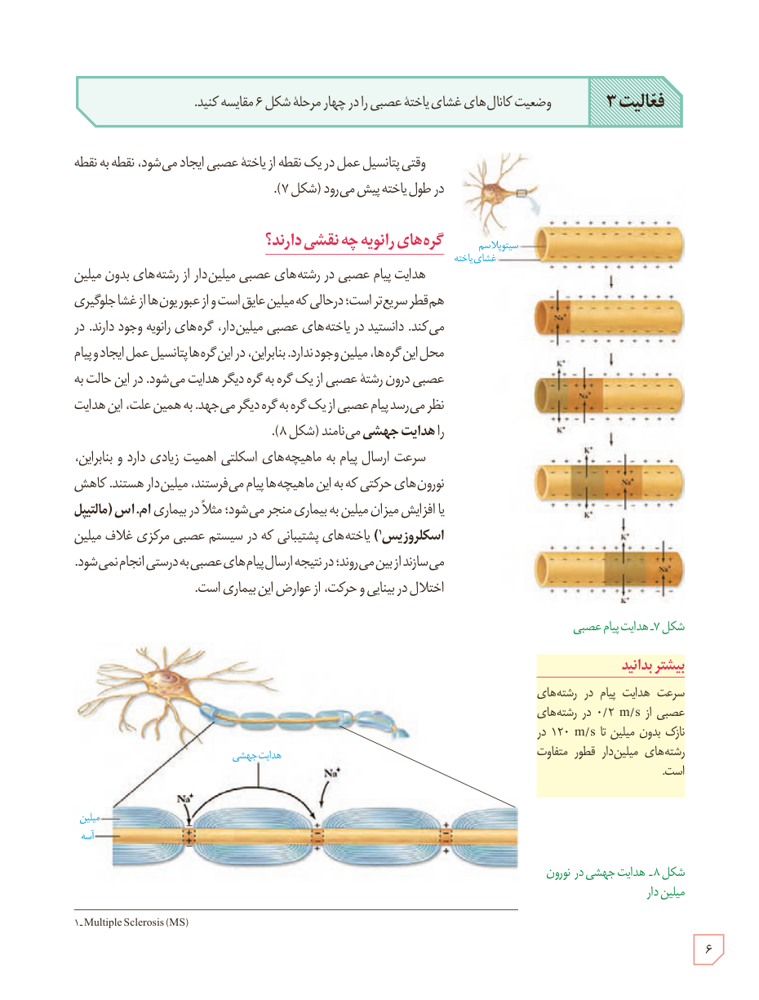

**فعالیت ۳:** وضعیت کانال‌های غشای یاختۀ عصبی را در چهار مرحله شکل ۶ مقایسه کنید.

وقتی پتانسیل عمل در یک نقطه از یاختۀ عصبی ایجاد می‌شود، نقطه به نقطه در طول یاخته پیش می‌رود (شکل ۷).

## گره‌های رانویه چه نقشی دارند؟

هدایت پیام عصبی در رشته‌های عصبی میلین‌دار از رشته‌های بدون میلین هم‌قطر سریع‌تر است؛ درحالی که میلین عایق است و از عبور یون‌ها از غشا جلوگیری می‌کند. دانستید در یاخته‌های عصبی میلین‌دار، گره‌های رانویه وجود دارند. در محل این گره‌ها، میلین وجود ندارد. بنابراین، در این گره‌ها پتانسیل عمل ایجاد و پیام عصبی درون رشتۀ عصبی از یک گره به گره دیگر هدایت می‌شود. در این حالت به نظر می‌رسد پیام عصبی از یک گره به گره دیگر می‌جهد. به همین علت، این هدایت را **هدایت جهشی** می‌نامند (شکل ۸).

سرعت ارسال پیام به ماهیچه‌های اسکلتی اهمیت زیادی دارد و بنابراین، نورون‌های حرکتی که به این ماهیچه‌ها پیام می‌فرستند، میلین‌دار هستند. کاهش یا افزایش میزان میلین به بیماری منجر می‌شود؛ مثلاً در بیماری **ام.اس (مالتیپل اسکلروزیس)** یاخته‌های پشتیبانی که در سیستم عصبی مرکزی غلاف میلین می‌سازند از بین می‌روند؛ در نتیجه ارسال پیام‌های عصبی به درستی انجام نمی‌شود. اختلال در بینایی و حرکت، از عوارض این بیماری است.

### بیشتر بدانید

سرعت هدایت پیام در رشته‌های عصبی از ۰/۲ m/s در رشته‌های باریک بدون میلین تا ۱۲۰ m/s در رشته‌های میلین‌دار قطور متفاوت است.

شکل ۷ـ هدایت پیام عصبی  
شکل ۸ـ هدایت جهشی در نورون میلین‌دار

۱- Multiple Sclerosis (MS)

۶

