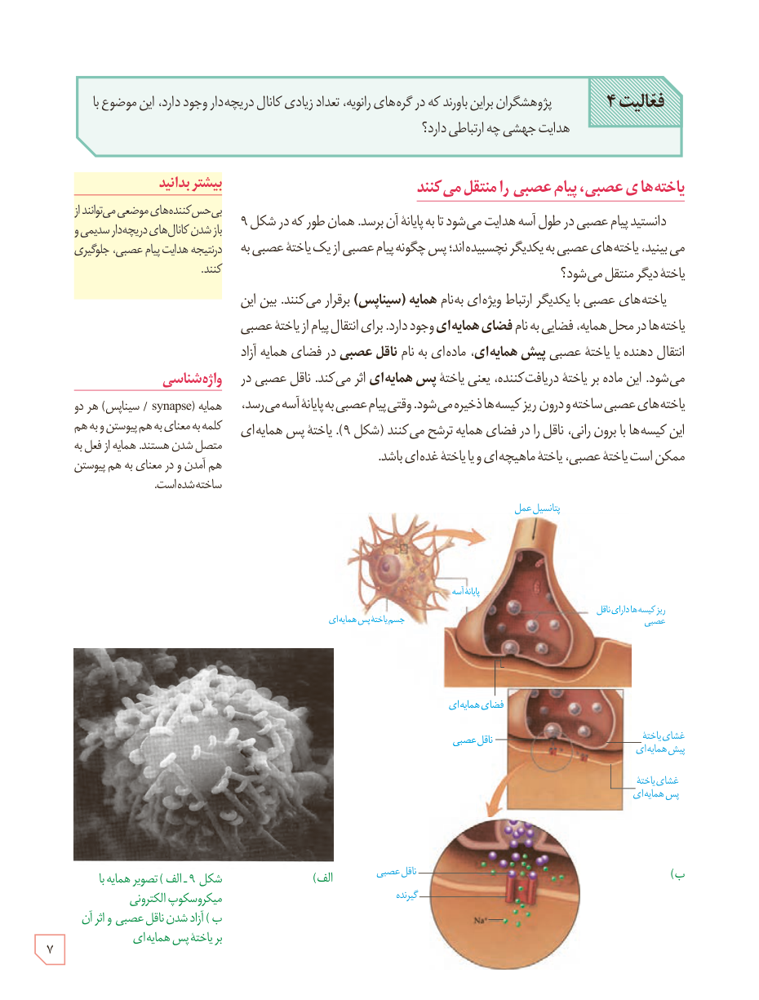

**فعالیت ۴:** پژوهشگران بر این باورند که در گره‌های رانویه، تعداد زیادی کانال دریچه‌دار وجود دارد. این موضوع با هدایت جهشی چه ارتباطی دارد؟

## یاخته‌های عصبی، پیام عصبی را منتقل می‌کنند

دانستید پیام عصبی در طول آسه هدایت می‌شود تا به پایانۀ آن برسد. همان‌طور که در شکل ۹ می‌بینید، یاخته‌های عصبی به یکدیگر نچسبیده‌اند؛ پس چگونه پیام عصبی از یک یاختۀ عصبی به یاختۀ دیگر منتقل می‌شود؟

یاخته‌های عصبی با یکدیگر ارتباط ویژه‌ای به نام **همایه (سیناپس)** برقرار می‌کنند. بین این یاخته‌ها در محل همایه، فضایی به نام **فضای همایه‌ای** وجود دارد. برای انتقال پیام از یاختۀ عصبی انتقال‌دهنده یا یاختۀ عصبی **پیش همایه‌ای**، ماده‌ای به نام **ناقل عصبی** در فضای همایه آزاد می‌شود. این ماده بر یاختۀ دریافت‌کننده، یعنی یاختۀ **پس همایه‌ای** اثر می‌کند. ناقل عصبی در یاخته‌های عصبی ساخته و درون ریزکیسه‌ها ذخیره می‌شود. وقتی پیام عصبی به پایانۀ آسه می‌رسد، این کیسه‌ها با برون‌رانی، ناقل را در فضای همایه ترشح می‌کنند (شکل ۹). یاختۀ پس همایه‌ای ممکن است یاختۀ عصبی، یاختۀ ماهیچه‌ای و یا یاختۀ غده‌ای باشد.

### بیشتر بدانید

بی‌حس‌کننده‌های موضعی می‌توانند از باز شدن کانال‌های دریچه‌دار سدیمی و در نتیجه هدایت پیام عصبی، جلوگیری کنند.

### واژه‌شناسی

همایه (synapse / سیناپس) هر دو کلمه به معنای به هم پیوستن و به هم متصل شدن هستند. همایه از فعل به هم آمدن و در معنای به هم پیوستن ساخته شده است.

شکل ۹ـ الف) تصویر همایه با میکروسکوپ الکترونی، ب) آزاد شدن ناقل عصبی و اثر آن بر یاختۀ پس همایه‌ای

۷

