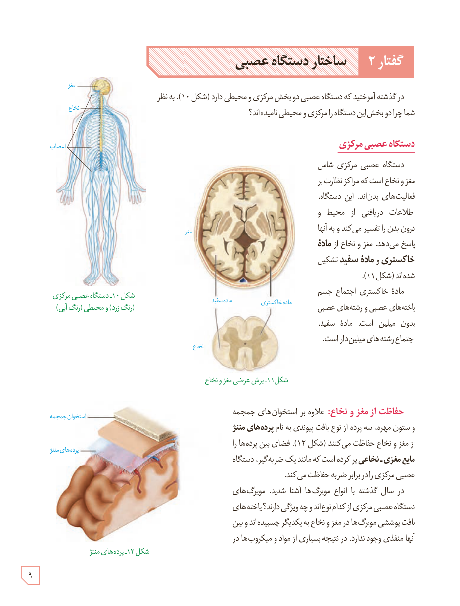

# گفتار ۲: ساختار دستگاه عصبی

در گذشته آموختید که دستگاه عصبی دو بخش مرکزی و محیطی دارد (شکل ۱۰). به نظر شما چرا دو بخش این دستگاه را مرکزی و محیطی نامیده‌اند؟

## دستگاه عصبی مرکزی

دستگاه عصبی مرکزی شامل مغز و نخاع است که مراکز نظارت بر فعالیت‌های بدن‌اند. این دستگاه، اطلاعات دریافتی از محیط و درون بدن را تفسیر می‌کند و به آنها پاسخ می‌دهد. مغز و نخاع از **مادۀ خاکستری** و **مادۀ سفید** تشکیل شده‌اند (شکل ۱۱).

مادۀ خاکستری اجتماع جسم یاخته‌های عصبی و رشته‌های عصبی بدون میلین است. مادۀ سفید، اجتماع رشته‌های میلین‌دار است.

**حفاظت از مغز و نخاع:** علاوه بر استخوان‌های جمجمه و ستون مهره، سه پرده از نوع بافت پیوندی به نام **پرده‌های مننژ** از مغز و نخاع حفاظت می‌کنند (شکل ۱۲). فضای بین پرده‌ها را **مایع مغزی ـ نخاعی** پر کرده است که مانند یک ضربه‌گیر، دستگاه عصبی مرکزی را در برابر ضربه حفاظت می‌کند.

در سال گذشته با انواع مویرگ‌ها آشنا شدید. مویرگ‌های دستگاه عصبی مرکزی از کدام نوع‌اند و چه ویژگی دارند؟ یاخته‌های بافت پوششی مویرگ‌ها در مغز و نخاع به یکدیگر چسبیده‌اند و بین آنها منفذی وجود ندارد. در نتیجه بسیاری از مواد و میکروب‌ها در

شکل ۱۰ـ دستگاه عصبی مرکزی (رنگ زرد) و محیطی (رنگ آبی)  
شکل ۱۱ـ برش عرضی مغز و نخاع  
شکل ۱۲ـ پرده‌های مننژ

۹

