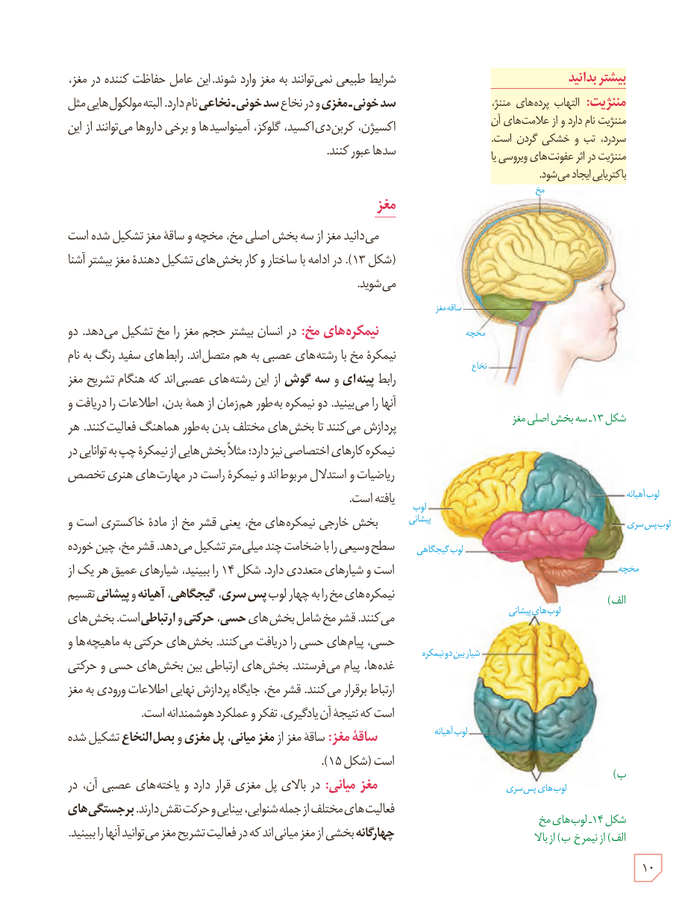

شرایط طبیعی نمی‌توانند به مغز وارد شوند. این عامل حفاظت‌کننده در مغز، **سد خونی ـ مغزی** و در نخاع **سد خونی ـ نخاعی** نام دارد. البته مولکول‌هایی مثل اکسیژن، کربن‌دی‌اکسید، گلوکز، آمینواسیدها و برخی داروها می‌توانند از این سدها عبور کنند.

## مغز

می‌دانید مغز از سه بخش اصلی مخ، مخچه و ساقۀ مغز تشکیل شده است (شکل ۱۳). در ادامه با ساختار و کار بخش‌های تشکیل‌دهندۀ مغز بیشتر آشنا می‌شوید.

**نیمکره‌های مخ:** در انسان بیشتر حجم مغز را مخ تشکیل می‌دهد. دو نیمکرۀ مخ با رشته‌های عصبی به هم متصل‌اند. رابط‌های سفید رنگ به نام رابط پینه‌ای و سه‌گوش از این رشته‌های عصبی‌اند که هنگام تشریح مغز آنها را می‌بینید. دو نیمکره به‌طور همزمان از همه بدن، اطلاعات را دریافت و پردازش می‌کنند تا بخش‌های مختلف بدن به‌طور هماهنگ فعالیت کنند. هر نیمکره کارهای اختصاصی نیز دارد؛ مثلاً بخش‌هایی از نیمکرۀ چپ به توانایی در ریاضیات و استدلال مربوط‌اند و نیمکرۀ راست در مهارت‌های هنری تخصص یافته است.

بخش خارجی نیمکره‌های مخ، یعنی قشر مخ از مادۀ خاکستری است و سطح وسیعی را با ضخامت چند میلی‌متر تشکیل می‌دهد. قشر مخ، چین خورده است و شیارهای متعددی دارد. شکل ۱۴ را ببینید. شیارهای عمیق هر یک از نیمکره‌های مخ را به چهار لوب پس‌سری، گیجگاهی، آهیانه و پیشانی تقسیم می‌کنند. قشر مخ شامل بخش‌های حسی، حرکتی و ارتباطی است. بخش‌های حسی، پیام‌های حسی را دریافت می‌کنند. بخش‌های حرکتی به ماهیچه‌ها و غده‌ها، پیام می‌فرستند. بخش‌های ارتباطی بین بخش‌های حسی و حرکتی ارتباط برقرار می‌کنند. قشر مخ، جایگاه پردازش نهایی اطلاعات ورودی به مغز است که نتیجۀ آن یادگیری، تفکر و عملکرد هوشمندانه است.

**ساقۀ مغز:** ساقۀ مغز از مغز میانی، پل مغزی و بصل‌النخاع تشکیل شده است (شکل ۱۵).

**مغز میانی:** در بالای پل مغزی قرار دارد و یاخته‌های عصبی آن، در فعالیت‌های مختلف از جمله شنوایی، بینایی و حرکت نقش دارند. برجستگی‌های چهارگانه بخشی از مغز میانی‌اند که در فعالیت تشریح مغز می‌توانید آنها را ببینید.

### بیشتر بدانید

**مننژیت:** التهاب پرده‌های مننژ، مننژیت نام دارد و از علامت‌های آن سردرد، تب و خشکی گردن است. مننژیت در اثر عفونت‌های ویروسی یا باکتریایی ایجاد می‌شود.

شکل ۱۳ـ سه بخش اصلی مغز  
شکل ۱۴ـ لوب‌های مخ، الف) از نیم‌رخ، ب) از بالا

۱۰

