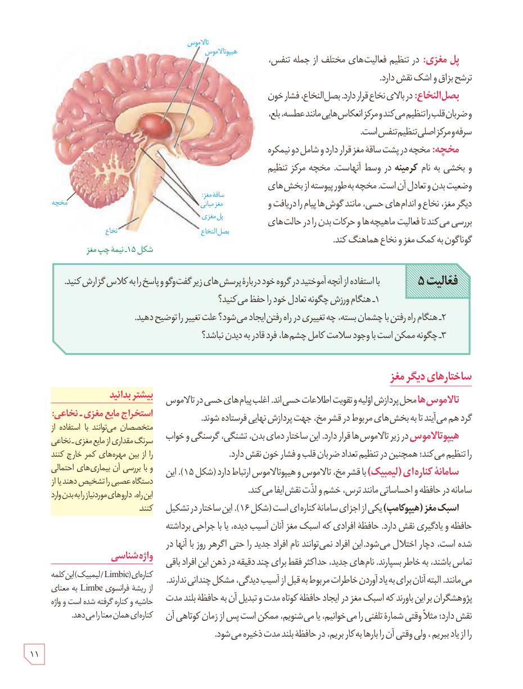

**پل مغزی:** در تنظیم فعالیت‌های مختلف از جمله تنفس، ترشح بزاق و اشک نقش دارد.

**بصل‌النخاع:** در بالای نخاع قرار دارد. بصل‌النخاع، فشار خون و ضربان قلب را تنظیم می‌کند و مرکز انعکاس‌هایی مانند عطسه، بلع، سرفه و مرکز اصلی تنظیم تنفس است.

**مخچه:** مخچه در پشت ساقۀ مغز قرار دارد و شامل دو نیمکره و بخشی به نام **کرمینه** در وسط آنهاست. مخچه مرکز تنظیم وضعیت بدن و تعادل آن است. مخچه به‌طور پیوسته از بخش‌های دیگر مغز، نخاع و اندام‌های حسی، مانند گوش‌ها پیام را دریافت و بررسی می‌کند تا فعالیت ماهیچه‌ها و حرکات بدن را در حالت‌های گوناگون به کمک مغز و نخاع هماهنگ کند.

شکل ۱۵ـ نیمۀ چپ مغز

**فعالیت ۵:** با استفاده از آنچه آموختید در گروه خود دربارۀ پرسش‌های زیر گفت‌وگو و پاسخ را به کلاس گزارش کنید.

۱- هنگام ورزش چگونه تعادل خود را حفظ می‌کنید؟  
۲- هنگام راه رفتن با چشمان بسته، چه تغییری در راه رفتن ایجاد می‌شود؟ علت تغییر را توضیح دهید.  
۳- چگونه ممکن است با وجود سلامت کامل چشم‌ها، فرد قادر به دیدن نباشد؟

## ساختارهای دیگر مغز

**تالاموس‌ها** محل پردازش اولیه و تقویت اطلاعات حسی‌اند. اغلب پیام‌های حسی در تالاموس گرد هم می‌آیند تا به بخش‌های مربوط در قشر مخ، جهت پردازش نهایی فرستاده شوند.

**هیپوتالاموس** در زیر تالاموس‌ها قرار دارد. این ساختار دمای بدن، تشنگی، گرسنگی و خواب را تنظیم می‌کند؛ همچنین در تنظیم تعداد ضربان قلب و فشار خون نقش دارد.

**سامانۀ کناره‌ای (لیمبیک)** با قشر مخ، تالاموس و هیپوتالاموس ارتباط دارد (شکل ۱۵). این سامانه در حافظه و احساساتی مانند ترس، خشم و لذت نقش ایفا می‌کند.

**اسبک مغز (هیپوکامپ)** یکی از اجزای سامانۀ کناره‌ای است (شکل ۱۶). این ساختار در تشکیل حافظه و یادگیری نقش دارد. حافظۀ افرادی که اسبک مغز آنان آسیب دیده، یا با جراحی برداشته شده است، دچار اختلال می‌شود. این افراد نمی‌توانند نام افراد جدید را حتی اگر هر روز با آنها در تماس باشند، به خاطر بسپارند. نام‌های جدید، حداکثر فقط برای چند دقیقه در ذهن این افراد باقی می‌مانند. البته آنان برای به یاد آوردن خاطرات مربوط به قبل از آسیب‌دیدگی، مشکل چندانی ندارند. پژوهشگران بر این باورند که اسبک مغز در ایجاد حافظۀ کوتاه‌مدت و تبدیل آن به حافظۀ بلندمدت نقش دارد؛ مثلاً وقتی شمارۀ تلفنی را می‌خوانیم، یا می‌شنویم، ممکن است پس از زمان کوتاهی آن را از یاد ببریم، ولی وقتی آن را بارها به کار ببریم، در حافظۀ بلندمدت ذخیره می‌شود.

### بیشتر بدانید: استخراج مایع مغزی ـ نخاعی

متخصصان می‌توانند با استفاده از سرنگ مقداری از مایع مغزی ـ نخاعی را از بین مهره‌های کمر خارج کنند و با بررسی آن بیماری‌های احتمالی دستگاه عصبی را تشخیص دهند یا از این راه، داروهای موردنیاز را به بدن وارد کنند.

### واژه‌شناسی

کناره‌ای (Limbic/ لیمبیک) این کلمه از ریشۀ فرانسوی Limbe به معنای حاشیه و کناره گرفته شده است و واژۀ کناره‌ای همان معنا را می‌دهد.

۱۱

