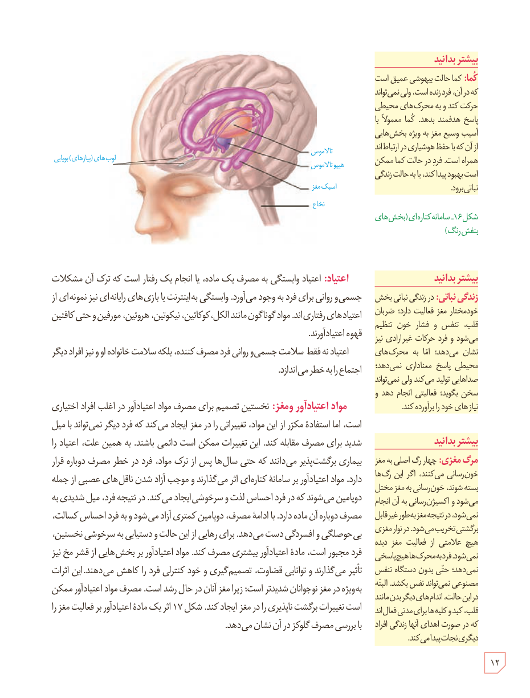

شکل ۱۶ـ سامانۀ کناره‌ای (بخش‌های بنفش‌رنگ)

**اعتیاد:** اعتیاد وابستگی به مصرف یک ماده، یا انجام یک رفتار است که ترک آن مشکلات جسمی و روانی برای فرد به وجود می‌آورد. وابستگی به اینترنت یا بازی‌های رایانه‌ای نیز نمونه‌ای از اعتیادهای رفتاری‌اند. مواد گوناگون مانند الکل، کوکائین، نیکوتین، هروئین، مورفین و حتی کافئین قهوه اعتیادآورند.

اعتیاد نه فقط سلامت جسمی و روانی فرد مصرف‌کننده، بلکه سلامت خانواده او و نیز افراد دیگر اجتماع را به خطر می‌اندازد.

**مواد اعتیادآور و مغز:** نخستین تصمیم برای مصرف مواد اعتیادآور در اغلب افراد اختیاری است، اما استفادۀ مکرر از این مواد، تغییراتی را در مغز ایجاد می‌کند که فرد دیگر نمی‌تواند با میل شدید برای مصرف مقابله کند. این تغییرات ممکن است دائمی باشند. به همین علت، اعتیاد را بیماری برگشت‌پذیر می‌دانند که حتی سال‌ها پس از ترک مواد، فرد در خطر مصرف دوباره قرار دارد. مواد اعتیادآور بر سامانۀ کناره‌ای اثر می‌گذارند و موجب آزاد شدن ناقل‌های عصبی از جمله دوپامین می‌شوند که در فرد احساس لذت و سرخوشی ایجاد می‌کند. در نتیجه فرد، میل شدیدی به مصرف دوبارۀ آن ماده دارد. با ادامۀ مصرف، دوپامین کمتری آزاد می‌شود و به فرد احساس کسالت، بی‌حوصلگی و افسردگی دست می‌دهد. برای رهایی از این حالت و دستیابی به سرخوشی نخستین، فرد مجبور است، مادۀ اعتیادآور بیشتری مصرف کند. مواد اعتیادآور بر بخش‌هایی از قشر مخ نیز تأثیر می‌گذارند و توانایی قضاوت، تصمیم‌گیری و خودکنترلی فرد را کاهش می‌دهند. این اثرات بویژه در مغز نوجوانان شدیدتر است؛ زیرا مغز آنان در حال رشد است. مصرف مواد اعتیادآور ممکن است تغییرات برگشت‌ناپذیری را در مغز ایجاد کند. شکل ۱۷ اثر یک مادۀ اعتیادآور بر فعالیت مغز را با بررسی مصرف گلوکز در آن نشان می‌دهد.

### بیشتر بدانید: کُما

کما حالت بیهوشی عمیق است که در آن، فرد زنده است، ولی نمی‌تواند حرکت کند و به محرک‌های محیطی پاسخ هدفمند بدهد. کما معمولاً با آسیب وسیع مغز به ویژه بخش‌هایی از آن که با حفظ هوشیاری در ارتباط‌اند همراه است. فرد در حالت کما ممکن است بهبود پیدا کند، یا به حالت زندگی نباتی برود.

### بیشتر بدانید: زندگی نباتی

در زندگی نباتی بخش خودمختار مغز فعالیت دارد؛ ضربان قلب، تنفس و فشار خون تنظیم می‌شود و فرد حرکات غیرارادی نیز نشان می‌دهد؛ اما به محرک‌های محیطی پاسخ معناداری نمی‌دهد؛ صداهایی تولید می‌کند ولی نمی‌تواند سخن بگوید؛ فعالیتی انجام دهد و نیازهای خود را برآورده کند.

### بیشتر بدانید: مرگ مغزی

چهار رگ اصلی به مغز خون‌رسانی می‌کنند. اگر این رگ‌ها بسته شوند، خون‌رسانی به مغز مختل می‌شود و اکسیژن‌رسانی به آن انجام نمی‌شود. در نتیجه مغز به‌طور غیرقابل برگشتی تخریب می‌شود. در نوار مغزی هیچ علامتی از فعالیت مغز دیده نمی‌شود. فرد به محرک‌ها هیچ پاسخی نمی‌دهد؛ حتی بدون دستگاه تنفس مصنوعی نمی‌تواند نفس بکشد. البته در این حالت، اندام‌های دیگر بدن مانند قلب، کبد و کلیه‌ها برای مدتی فعال‌اند که در صورت اهدای آنها زندگی افراد دیگری نجات پیدا می‌کند.

۱۲

