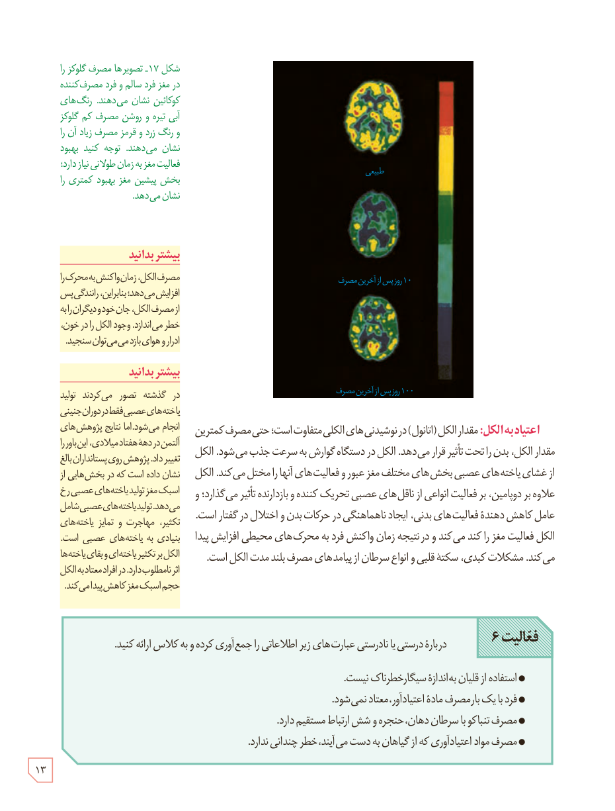

شکل ۱۷ـ تصویرها مصرف گلوکز را در مغز فرد سالم و فرد مصرف‌کنندۀ کوکائین نشان می‌دهند. رنگ‌های آبی تیره و روشن مصرف کم گلوکز و رنگ زرد و قرمز مصرف زیاد آن را نشان می‌دهند. توجه کنید بهبود فعالیت مغز به زمان طولانی نیاز دارد؛ بخش پیشین مغز بهبود کمتری را نشان می‌دهد.

**اعتیاد به الکل:** مقدار الکل (اتانول) در نوشیدنی‌های الکلی متفاوت است؛ حتی مصرف کمترین مقدار الکل، بدن را تحت تأثیر قرار می‌دهد. الکل در دستگاه گوارش به سرعت جذب می‌شود. الکل از غشای یاخته‌های عصبی بخش‌های مختلف مغز عبور و فعالیت‌های آنها را مختل می‌کند. الکل علاوه بر دوپامین، بر فعالیت انواعی از ناقل‌های عصبی تحریک‌کننده و بازدارنده تأثیر می‌گذارد؛ و عامل کاهش‌دهندۀ فعالیت‌های بدنی، ایجاد ناهماهنگی در حرکات بدن و اختلال در گفتار است. الکل فعالیت مغز را کند می‌کند و در نتیجه زمان واکنش فرد به محرک‌های محیطی افزایش پیدا می‌کند. مشکلات کبدی، سکتۀ قلبی و انواع سرطان از پیامدهای مصرف بلندمدت الکل است.

### بیشتر بدانید

مصرف الکل، زمان واکنش به محرک را افزایش می‌دهد؛ بنابراین، رانندگی پس از مصرف الکل، جان خود و دیگران را به خطر می‌اندازد. وجود الکل را در خون، ادرار و هوای بازدم می‌توان سنجید.

### بیشتر بدانید

در گذشته تصور می‌کردند تولید یاخته‌های عصبی فقط در دوران جنینی انجام می‌شود. اما نتایج پژوهش‌های آلتمن در دهۀ هفتاد میلادی، این باور را تغییر داد. پژوهش روی پستانداران بالغ نشان داده است که در بخش‌هایی از اسبک مغز تولید یاخته‌های عصبی رخ می‌دهد. تولید یاخته‌های عصبی شامل تکثیر، مهاجرت و تمایز یاخته‌های بنیادی به یاخته‌های عصبی است. الکل بر تکثیر یاخته‌ای و بقای یاخته‌ها اثر نامطلوب دارد. در افراد معتاد به الکل حجم اسبک مغز کاهش پیدا می‌کند.

**فعالیت ۶:** دربارۀ درستی یا نادرستی عبارت‌های زیر اطلاعاتی را جمع‌آوری کرده و به کلاس ارائه کنید.

- استفاده از قلیان به اندازۀ سیگار خطرناک نیست.
- فرد با یک بار مصرف مادۀ اعتیادآور، معتاد نمی‌شود.
- مصرف تنباکو با سرطان دهان، حنجره و شش ارتباط مستقیم دارد.
- مصرف مواد اعتیادآوری که از گیاهان به دست می‌آیند، خطر چندانی ندارد.

۱۳

