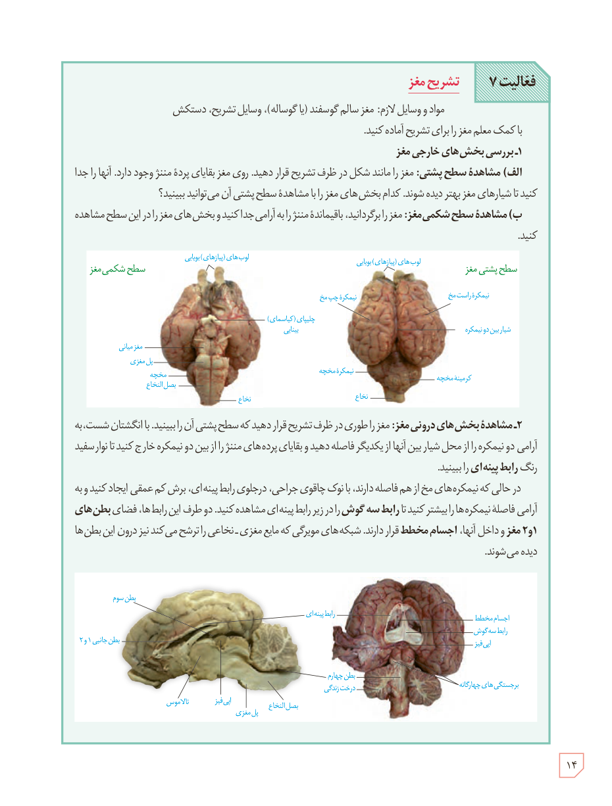

# فعالیت ۷: تشریح مغز

مواد و وسایل لازم: مغز سالم گوسفند (یا گوساله)، وسایل تشریح، دستکش

با کمک معلم مغز را برای تشریح آماده کنید.

**۱- بررسی بخش‌های خارجی مغز**

الف) **مشاهدۀ سطح پشتی:** مغز را مانند شکل در ظرف تشریح قرار دهید. روی مغز بقایای پردۀ مننژ وجود دارد. آنها را جدا کنید تا شیارهای مغز بهتر دیده شوند. کدام بخش‌های مغز را با مشاهدۀ سطح پشتی آن می‌توانید ببینید؟

ب) **مشاهدۀ سطح شکمی مغز:** مغز را برگردانید، باقی‌ماندۀ مننژ را به آرامی جدا کنید و بخش‌های مغز را در این سطح مشاهده کنید.

**۲- مشاهدۀ بخش‌های درونی مغز:** مغز را طوری در ظرف تشریح قرار دهید که سطح پشتی آن را ببینید. با انگشتان شست، به آرامی دو نیمکره را از محل شیار بین آنها از یکدیگر فاصله دهید و بقایای پرده‌های مننژ را از بین دو نیمکره خارج کنید تا نوار سفید رنگ **رابط پینه‌ای** را ببینید.

در حالی که نیمکره‌های مخ از هم فاصله دارند، با نوک چاقوی جراحی، در جلوی رابط پینه‌ای، برش کم‌عمقی ایجاد کنید و به آرامی فاصلۀ نیمکره‌ها را بیشتر کنید تا **رابط سه‌گوش** را در زیر رابط پینه‌ای مشاهده کنید. دو طرف این رابط‌ها، فضای **بطن‌های ۱ و ۲ مغز** و داخل آنها، **اجسام مخطط** قرار دارند. شبکه‌های مویرگی که مایع مغزی ـ نخاعی را ترشح می‌کنند نیز درون این بطن‌ها دیده می‌شوند.

۱۴

