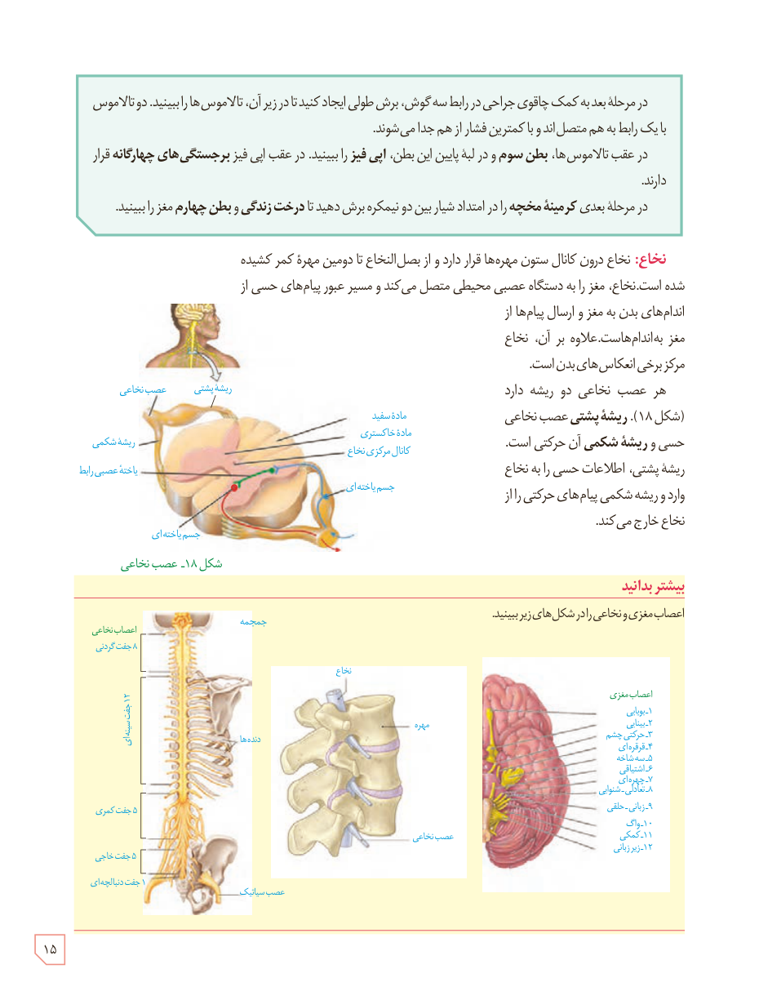

در مرحلۀ بعد به کمک چاقوی جراحی در رابط سه‌گوش، برش طولی ایجاد کنید تا در زیر آن، تالاموس‌ها را ببینید. دو تالاموس با یک رابط به هم متصل‌اند و با کمترین فشار از هم جدا می‌شوند.

در عقب تالاموس‌ها، **بطن سوم** و در لبۀ پایین این بطن، **اپی‌فیز** را ببینید. در عقب اپی‌فیز **برجستگی‌های چهارگانه** قرار دارند.

در مرحلۀ بعدی **کرمینۀ مخچه** را در امتداد شیار بین دو نیمکره برش دهید تا **درخت زندگی** و **بطن چهارم** مغز را ببینید.

**نخاع:** نخاع درون کانال ستون مهره‌ها قرار دارد و از بصل‌النخاع تا دومین مهرۀ کمر کشیده شده است. نخاع، مغز را به دستگاه عصبی محیطی متصل می‌کند و مسیر عبور پیام‌های حسی از اندام‌های بدن به مغز و ارسال پیام‌ها از مغز به اندام‌هاست. علاوه بر آن، نخاع مرکز برخی انعکاس‌های بدن است.

هر عصب نخاعی دو ریشه دارد (شکل ۱۸). **ریشۀ پشتی** عصب نخاعی حسی و **ریشۀ شکمی** آن حرکتی است. ریشۀ پشتی، اطلاعات حسی را به نخاع وارد و ریشۀ شکمی پیام‌های حرکتی را از نخاع خارج می‌کند.

شکل ۱۸ـ عصب نخاعی

### بیشتر بدانید

اعصاب مغزی و نخاعی را در شکل‌های زیر ببینید.

۱۵

