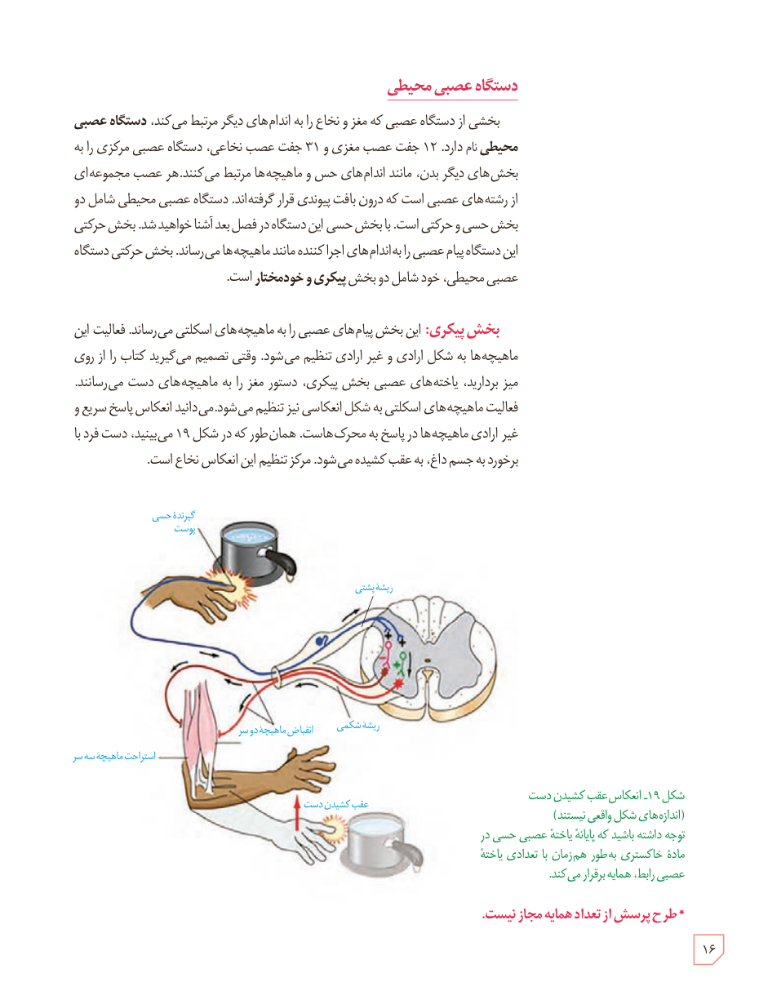

## دستگاه عصبی محیطی

بخشی از دستگاه عصبی که مغز و نخاع را به اندام‌های دیگر مرتبط می‌کند، **دستگاه عصبی محیطی** نام دارد. ۱۲ جفت عصب مغزی و ۳۱ جفت عصب نخاعی، دستگاه عصبی مرکزی را به بخش‌های دیگر بدن، مانند اندام‌های حس و ماهیچه‌ها مرتبط می‌کنند. هر عصب مجموعه‌ای از رشته‌های عصبی است که درون بافت پیوندی قرار گرفته‌اند. دستگاه عصبی محیطی شامل دو بخش حسی و حرکتی است. با بخش حسی این دستگاه در فصل بعد آشنا خواهید شد. بخش حرکتی این دستگاه پیام عصبی را به اندام‌های اجراکننده مانند ماهیچه‌ها می‌رساند. بخش حرکتی دستگاه عصبی محیطی، خود شامل دو بخش **پیکری و خودمختار** است.

**بخش پیکری:** این بخش پیام‌های عصبی را به ماهیچه‌های اسکلتی می‌رساند. فعالیت این ماهیچه‌ها به شکل ارادی و غیرارادی تنظیم می‌شود. وقتی تصمیم می‌گیرید کتاب را از روی میز بردارید، یاخته‌های عصبی بخش پیکری، دستور مغز را به ماهیچه‌های دست می‌رسانند. فعالیت ماهیچه‌های اسکلتی به شکل انعکاسی نیز تنظیم می‌شود. می‌دانید انعکاس پاسخ سریع و غیرارادی ماهیچه‌ها در پاسخ به محرک‌هاست. همان‌طور که در شکل ۱۹ می‌بینید، دست فرد با برخورد به جسم داغ، به عقب کشیده می‌شود. مرکز تنظیم این انعکاس نخاع است.

شکل ۱۹ـ انعکاس عقب کشیدن دست (اندازه‌های شکل واقعی نیستند). توجه داشته باشید که پایانۀ یاختۀ عصبی حسی در مادۀ خاکستری به‌طور همزمان با تعدادی یاختۀ عصبی رابط، همایه برقرار می‌کند.

* طرح پرسش از تعداد همایه مجاز نیست.

۱۶

