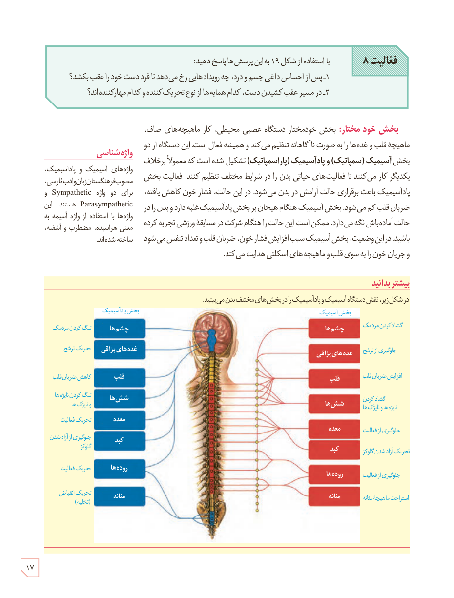

**فعالیت ۸:** با استفاده از شکل ۱۹ به این پرسش‌ها پاسخ دهید:

۱- پس از احساس داغی جسم و درد، چه رویدادهایی رخ می‌دهد تا فرد دست خود را عقب بکشد؟  
۲- در مسیر عقب کشیدن دست، کدام همایه‌ها از نوع تحریک‌کننده و کدام مهارکننده‌اند؟

**بخش خودمختار:** بخش خودمختار دستگاه عصبی محیطی، کار ماهیچه‌های صاف، ماهیچۀ قلب و غده‌ها را به صورت ناآگاهانه تنظیم می‌کند و همیشه فعال است. این دستگاه از دو بخش **آسیمپیک (سمپاتیک)** و **پادآسیمپیک (پاراسمپاتیک)** تشکیل شده است که معمولاً برخلاف یکدیگر کار می‌کنند تا فعالیت‌های حیاتی بدن را در شرایط مختلف تنظیم کنند. فعالیت بخش پادآسیمپیک باعث برقراری حالت آرامش در بدن می‌شود. در این حالت، فشار خون کاهش یافته، ضربان قلب کم می‌شود. بخش آسیمپیک هنگام هیجان بر بخش پادآسیمپیک غلبه دارد و بدن را در حالت آماده‌باش نگه می‌دارد. ممکن است این حالت را هنگام شرکت در مسابقۀ ورزشی تجربه کرده باشید. در این وضعیت، بخش آسیمپیک سبب افزایش فشار خون، ضربان قلب و تعداد تنفس می‌شود و جریان خون را به سوی قلب و ماهیچه‌های اسکلتی هدایت می‌کند.

### واژه‌شناسی

واژه‌های آسیمپیک و پادآسیمپیک، مصوب فرهنگستان زبان و ادب فارسی، برای دو واژۀ Sympathetic و Parasympathetic هستند. این واژه‌ها با استفاده از واژۀ آسیمه به معنی هراسیده، مضطرب و آشفته، ساخته شده‌اند.

### بیشتر بدانید

در شکل زیر، نقش دستگاه آسیمپیک و پادآسیمپیک را در بخش‌های مختلف بدن می‌بینید.

۱۷

