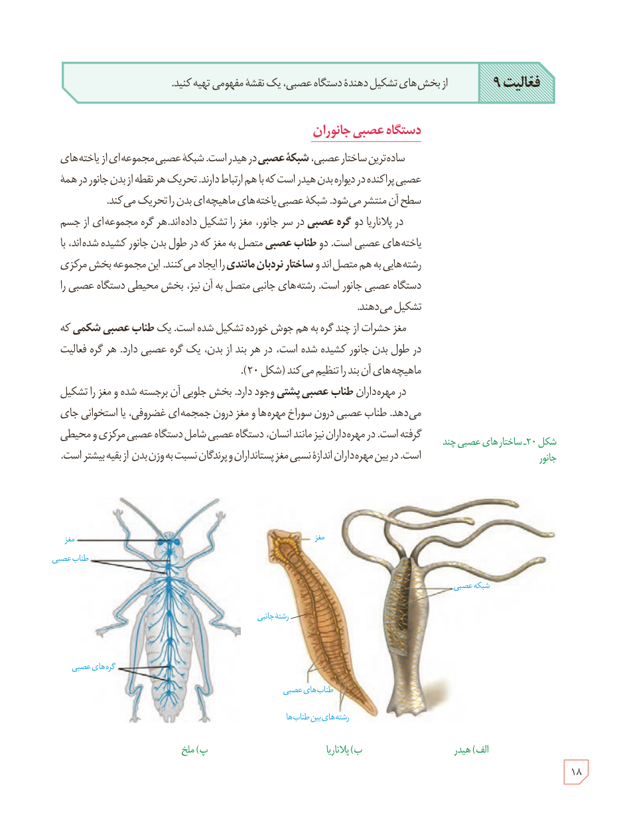

**فعالیت ۹:** از بخش‌های تشکیل‌دهندۀ دستگاه عصبی، یک نقشۀ مفهومی تهیه کنید.

## دستگاه عصبی جانوران

ساده‌ترین ساختار عصبی، **شبکۀ عصبی** در هیدر است. شبکۀ عصبی مجموعه‌ای از یاخته‌های عصبی پراکنده در دیوارۀ بدن هیدر است که با هم ارتباط دارند. تحریک هر نقطه از بدن جانور در همۀ سطح آن منتشر می‌شود. شبکۀ عصبی یاخته‌های ماهیچه‌ای بدن را تحریک می‌کند.

در پلاناریا دو **گره عصبی** در سر جانور، مغز را تشکیل داده‌اند. هر گره مجموعه‌ای از جسم یاخته‌های عصبی است. دو **طناب عصبی** متصل به مغز که در طول بدن جانور کشیده شده‌اند، با رشته‌هایی به هم متصل‌اند و **ساختار نردبان‌مانندی** را ایجاد می‌کنند. این مجموعه بخش مرکزی دستگاه عصبی جانور است. رشته‌های جانبی متصل به آن نیز، بخش محیطی دستگاه عصبی را تشکیل می‌دهند.

مغز حشرات از چند گره به هم جوش خورده تشکیل شده است. یک **طناب عصبی شکمی** که در طول بدن جانور کشیده شده است، در هر بند از بدن، یک گره عصبی دارد. هر گره فعالیت ماهیچه‌های آن بند را تنظیم می‌کند (شکل ۲۰).

در مهره‌داران **طناب عصبی پشتی** وجود دارد. بخش جلویی آن برجسته شده و مغز را تشکیل می‌دهد. طناب عصبی درون سوراخ مهره‌ها و مغز درون جمجمه‌ای غضروفی، یا استخوانی جای گرفته است. در مهره‌داران نیز مانند انسان، دستگاه عصبی شامل دستگاه عصبی مرکزی و محیطی است. در بین مهره‌داران اندازۀ نسبی مغز پستانداران و پرندگان نسبت به وزن بدن از بقیه بیشتر است.

شکل ۲۰ـ ساختارهای عصبی چند جانور: الف) هیدر، ب) پلاناریا، پ) ملخ

۱۸

