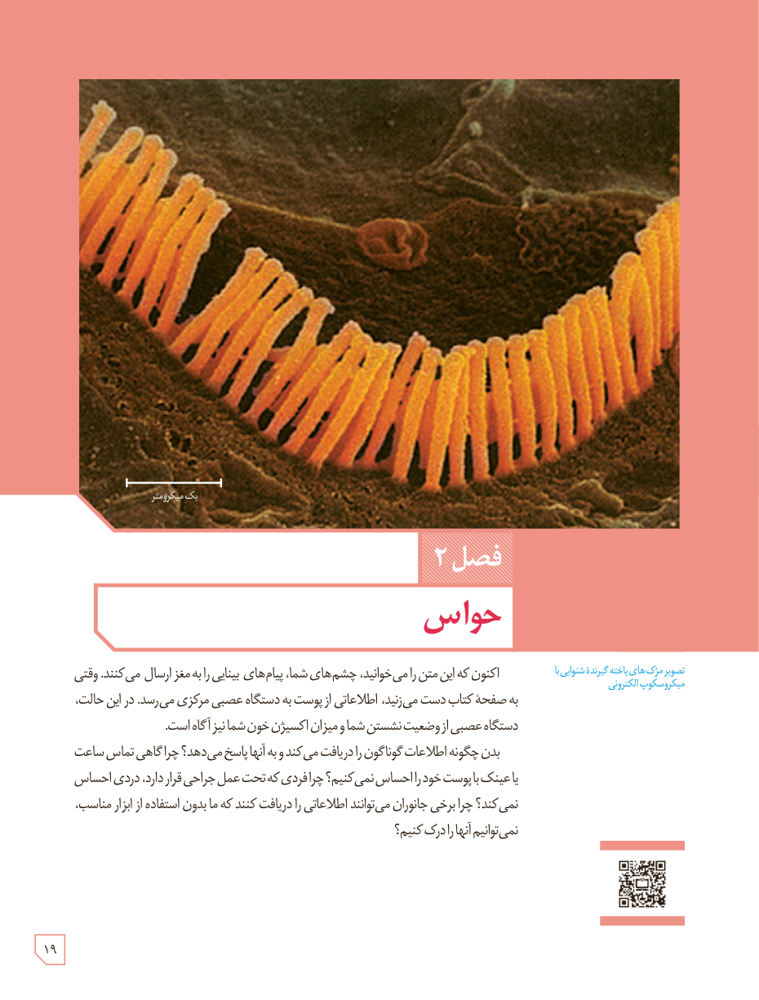

# فصل ۲: حواس

تصویر مژک‌های یاختۀ گیرندۀ شنوایی با میکروسکوپ الکترونی

اکنون که این متن را می‌خوانید، چشم‌های شما پیام‌های بینایی را به مغز ارسال می‌کنند. وقتی به صفحۀ کتاب دست می‌زنید، اطلاعاتی از پوست به دستگاه عصبی مرکزی می‌رسد. در این حالت، دستگاه عصبی از وضعیت نشستن شما و میزان اکسیژن خون شما نیز آگاه است.

بدن چگونه اطلاعات گوناگون را دریافت می‌کند و به آنها پاسخ می‌دهد؟ چرا گاهی تماس ساعت یا عینک با پوست خود را احساس نمی‌کنیم؟ چرا فردی که تحت عمل جراحی قرار دارد، دردی احساس نمی‌کند؟ چرا برخی جانوران می‌توانند اطلاعاتی را دریافت کنند که ما بدون استفاده از ابزار مناسب، نمی‌توانیم آنها را درک کنیم؟

۱۹

