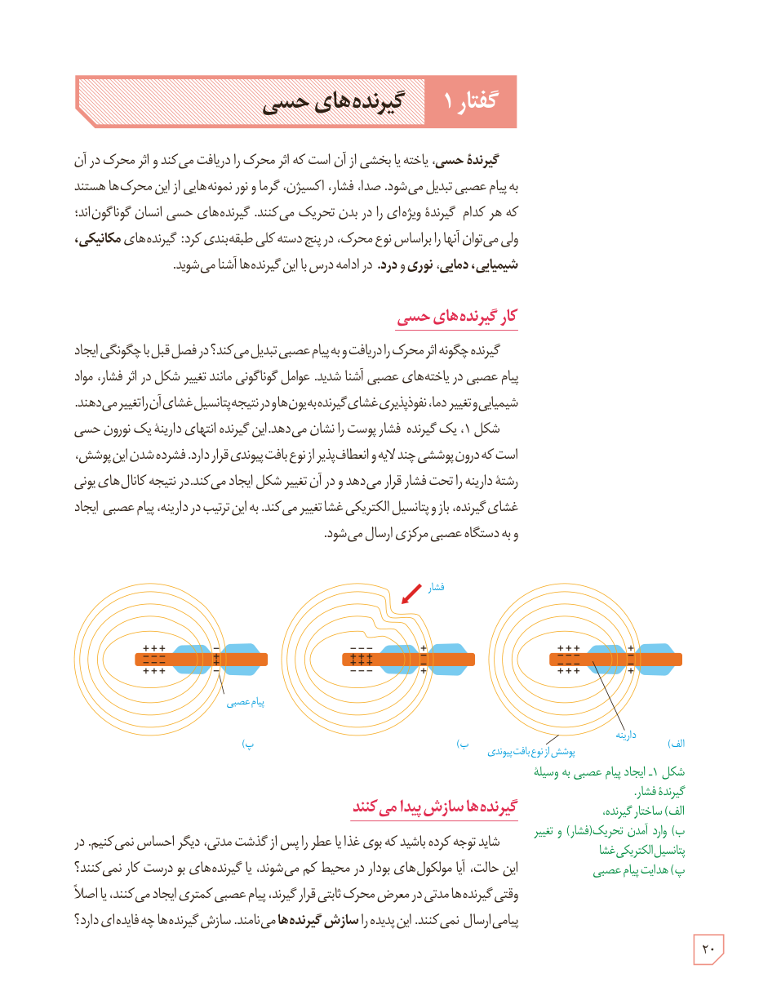

# گفتار ۱: گیرنده‌های حسی

**گیرندۀ حسی**، یاخته یا بخشی از آن است که اثر محرک را دریافت می‌کند و اثر محرک در آن به پیام عصبی تبدیل می‌شود. صدا، فشار، اکسیژن، گرما و نور نمونه‌هایی از این محرک‌ها هستند که هر کدام گیرندۀ ویژه‌ای را در بدن تحریک می‌کنند. گیرنده‌های حسی انسان گوناگون‌اند؛ ولی می‌توان آنها را براساس نوع محرک، در پنج دستۀ کلی طبقه‌بندی کرد: گیرنده‌های **مکانیکی، شیمیایی، دمایی، نوری و درد**. در ادامۀ درس با این گیرنده‌ها آشنا می‌شوید.

## کار گیرنده‌های حسی

گیرنده چگونه اثر محرک را دریافت و به پیام عصبی تبدیل می‌کند؟ در فصل قبل با چگونگی ایجاد پیام عصبی در یاخته‌های عصبی آشنا شدید. عوامل گوناگونی مانند تغییر شکل در اثر فشار، مواد شیمیایی و تغییر دما، نفوذپذیری غشای گیرنده به یون‌ها و در نتیجه پتانسیل غشای آن را تغییر می‌دهند.

شکل ۱، یک گیرندۀ فشار پوست را نشان می‌دهد. این گیرنده انتهای دارینۀ یک نورون حسی است که درون پوششی چند لایه و انعطاف‌پذیر از نوع بافت پیوندی قرار دارد. فشرده شدن این پوشش، رشتۀ دارینه را تحت فشار قرار می‌دهد و در آن تغییر شکل ایجاد می‌کند. در نتیجه کانال‌های یونی غشای گیرنده، باز و پتانسیل الکتریکی غشا تغییر می‌کند. به این ترتیب در دارینه، پیام عصبی ایجاد و به دستگاه عصبی مرکزی ارسال می‌شود.

شکل ۱ـ ایجاد پیام عصبی به وسیلۀ گیرندۀ فشار. الف) ساختار گیرنده، ب) وارد آمدن تحریک (فشار) و تغییر پتانسیل الکتریکی غشا، پ) هدایت پیام عصبی

## گیرنده‌ها سازش پیدا می‌کنند

شاید توجه کرده باشید که بوی غذا یا عطر را پس از گذشت مدتی، دیگر احساس نمی‌کنیم. در این حالت، آیا مولکول‌های بودار در محیط کم می‌شوند، یا گیرنده‌های بو درست کار نمی‌کنند؟ وقتی گیرنده‌ها مدتی در معرض محرک ثابتی قرار گیرند، پیام عصبی کمتری ایجاد می‌کنند، یا اصلاً پیامی ارسال نمی‌کنند. این پدیده را **سازش گیرنده‌ها** می‌نامند. سازش گیرنده‌ها چه فایده‌ای دارد؟

۲۰

