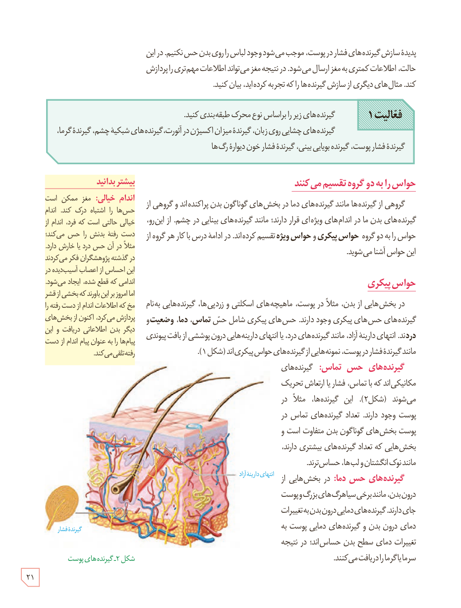

پدیدۀ سازش گیرنده‌های فشار در پوست، موجب می‌شود وجود لباس را روی بدن حس نکنیم. در این حالت، اطلاعات کمتری به مغز ارسال می‌شود. در نتیجه مغز می‌تواند اطلاعات مهم‌تری را پردازش کند. مثال‌های دیگری از سازش گیرنده‌ها را که تجربه کرده‌اید، بیان کنید.

**فعالیت ۱:** گیرنده‌های زیر را براساس نوع محرک طبقه‌بندی کنید.

گیرنده‌های چشایی روی زبان، گیرندۀ میزان اکسیژن در آئورت، گیرنده‌های شبکیۀ چشم، گیرندۀ گرما، گیرندۀ فشار پوست، گیرندۀ بویایی بینی، گیرندۀ فشار خون دیوارۀ رگ‌ها

## حواس را به دو گروه تقسیم می‌کنند

گروهی از گیرنده‌ها مانند گیرنده‌های دما در بخش‌های گوناگون بدن پراکنده‌اند و گروهی از گیرنده‌های بدن ما در اندام‌های ویژه‌ای قرار دارند؛ مانند گیرنده‌های بینایی در چشم. از این‌رو، حواس را به دو گروه **حواس پیکری** و **حواس ویژه** تقسیم کرده‌اند. در ادامۀ درس با کار هر گروه از این حواس آشنا می‌شوید.

## حواس پیکری

در بخش‌هایی از بدن، مثلاً در پوست، ماهیچه‌های اسکلتی و زردپی‌ها، گیرنده‌هایی به‌نام گیرنده‌های حس‌های پیکری وجود دارند. حس‌های پیکری شامل حس **تماس، دما، وضعیت و درد**ند. انتهای دارینۀ آزاد، مانند گیرنده‌های درد، یا انتهای دارینه‌هایی درون پوششی از بافت پیوندی مانند گیرندۀ فشار در پوست، نمونه‌هایی از گیرنده‌های حواس پیکری‌اند (شکل ۱).

**گیرنده‌های حس تماس:** گیرنده‌های مکانیکی‌اند که با تماس، فشار یا ارتعاش تحریک می‌شوند (شکل ۲). این گیرنده‌ها، مثلاً در پوست وجود دارند. تعداد گیرنده‌های تماس در پوست بخش‌های گوناگون بدن متفاوت است و بخش‌هایی که تعداد گیرنده‌های بیشتری دارند، مانند نوک انگشتان و لب‌ها، حساس‌ترند.

**گیرنده‌های حس دما:** در بخش‌هایی از درون بدن، مانند برخی سیاهرگ‌های بزرگ و پوست جای دارند. گیرنده‌های دمایی درون بدن به تغییرات دمای درون بدن و گیرنده‌های دمایی پوست به تغییرات دمای سطح بدن حساس‌اند؛ در نتیجه سرما یا گرما را دریافت می‌کنند.

### بیشتر بدانید: اندام خیالی

مغز ممکن است حس‌ها را اشتباه درک کند. اندام خیالی حالتی است که فرد، اندام از دست رفتۀ بدنش را حس می‌کند؛ مثلاً در آن حس درد یا خارش دارد. در گذشته پژوهشگران فکر می‌کردند این احساس از اعصاب آسیب‌دیدۀ اندامی که قطع شده، ایجاد می‌شود. اما امروزه بر این باورند که بخشی از قشر مخ که اطلاعات اندام از دست رفته را پردازش می‌کرد، اکنون از بخش‌های دیگر بدن اطلاعاتی دریافت و این پیام‌ها را به عنوان پیام اندام از دست رفته تلقی می‌کند.

شکل ۲ـ گیرنده‌های پوست

۲۱

