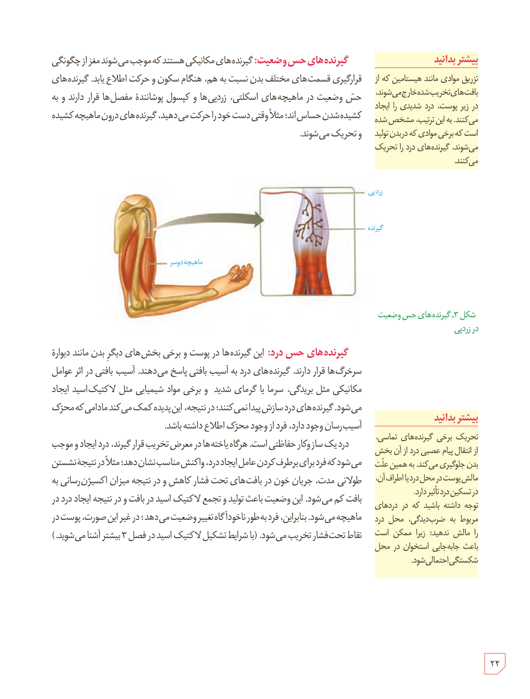

**گیرنده‌های حس وضعیت:** گیرنده‌های مکانیکی هستند که موجب می‌شوند مغز از چگونگی قرارگیری قسمت‌های مختلف بدن نسبت به هم، هنگام سکون و حرکت اطلاع یابد. گیرنده‌های حس وضعیت در ماهیچه‌های اسکلتی، زردپی‌ها و کپسول پوشانندۀ مفصل‌ها قرار دارند و به کشیده‌شدن حساس‌اند؛ مثلاً وقتی دست خود را حرکت می‌دهید، گیرنده‌های درون ماهیچه کشیده و تحریک می‌شوند.

شکل ۳ـ گیرنده‌های حس وضعیت در زردپی

**گیرنده‌های حس درد:** این گیرنده‌ها در پوست و برخی بخش‌های دیگر بدن مانند دیوارۀ سرخرگ‌ها قرار دارند. گیرنده‌های درد به آسیب بافتی پاسخ می‌دهند. آسیب بافتی در اثر عوامل مکانیکی مثل بریدگی، سرما یا گرمای شدید و برخی مواد شیمیایی مثل لاکتیک اسید ایجاد می‌شود. گیرنده‌های درد سازش پیدا نمی‌کنند؛ در نتیجه، این پدیده کمک می‌کند مادامی که محرک آسیب‌رسان وجود دارد، فرد از وجود محرک اطلاع داشته باشد.

درد یک سازوکار حفاظتی است. هرگاه یاخته‌ها در معرض تخریب قرار گیرند، درد ایجاد و موجب می‌شود که فرد برای برطرف کردن عامل ایجاد درد، واکنش مناسب نشان دهد؛ مثلاً در نتیجۀ نشستن طولانی مدت، جریان خون در بافت‌های تحت فشار کاهش و در نتیجه میزان اکسیژن‌رسانی به بافت کم می‌شود. این وضعیت باعث تولید و تجمع لاکتیک اسید در بافت و در نتیجه ایجاد درد در ماهیچه می‌شود. بنابراین، فرد به‌طور ناخودآگاه تغییر وضعیت می‌دهد؛ در غیر این صورت، پوست در نقاط تحت فشار تخریب می‌شود. (با شرایط تشکیل لاکتیک اسید در فصل ۳ بیشتر آشنا می‌شوید.)

### بیشتر بدانید

تزریق موادی مانند هیستامین که از بافت‌های تخریب‌شده خارج می‌شوند، در زیر پوست، درد شدیدی را ایجاد می‌کنند. به این ترتیب، مشخص شده است که برخی موادی که در بدن تولید می‌شوند، گیرنده‌های درد را تحریک می‌کنند.

### بیشتر بدانید

تحریک برخی گیرنده‌های تماس، از انتقال پیام عصبی درد از آن بخش بدن جلوگیری می‌کند. به همین علت مالش پوست در محل درد یا اطراف آن، در تسکین درد تأثیر دارد. توجه داشته باشید که در دردهای مربوط به ضرب‌دیدگی، محل درد را مالش ندهید؛ زیرا ممکن است باعث جابه‌جایی استخوان در محل شکستگی احتمالی شود.

۲۲

