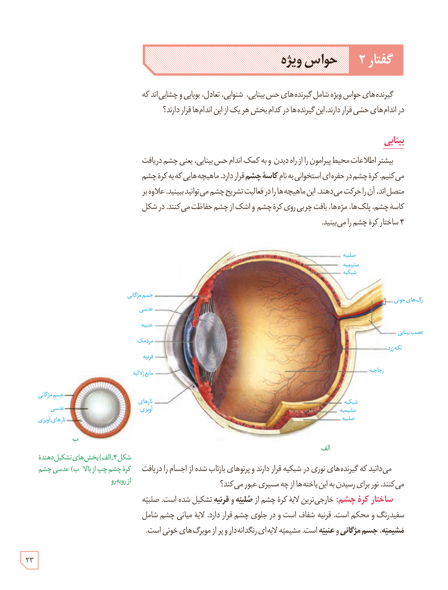

# گفتار ۲: حواس ویژه

گیرنده‌های حواس ویژه شامل گیرنده‌های حس بینایی، شنوایی، تعادل، بویایی و چشایی‌اند که در اندام‌های حسی قرار دارند. این گیرنده‌ها در کدام بخش هر یک از این اندام‌ها قرار دارند؟

## بینایی

بیشتر اطلاعات محیط پیرامون را از راه دیدن و به کمک اندام حس بینایی، یعنی چشم دریافت می‌کنیم. کرۀ چشم در حفره‌ای استخوانی به نام **کاسۀ چشم** قرار دارد. ماهیچه‌هایی که به کرۀ چشم متصل‌اند، آن را حرکت می‌دهند. این ماهیچه‌ها را در فعالیت تشریح چشم می‌توانید ببینید. علاوه بر کاسۀ چشم، پلک‌ها، مژه‌ها، بافت چربی روی کرۀ چشم و اشک از چشم حفاظت می‌کنند. در شکل ۴ ساختار کرۀ چشم را می‌بینید.

می‌دانید که گیرنده‌های نوری در شبکیه قرار دارند و پرتوهای بازتاب شده از اجسام را دریافت می‌کنند. نور برای رسیدن به این یاخته‌ها از چه مسیری عبور می‌کند؟

**ساختار کرۀ چشم:** خارجی‌ترین لایۀ کرۀ چشم از **صلبیه و قرنیه** تشکیل شده است. صلبیه سفیدرنگ و محکم است. قرنیه شفاف است و در جلوی چشم قرار دارد. لایۀ میانی چشم شامل **مشیمیه، جسم مژگانی و عنبیه** است. مشیمیه لایه‌ای رنگدانه‌دار و پر از مویرگ‌های خونی است.

شکل ۴ـ الف) بخش‌های تشکیل‌دهندۀ کرۀ چشم چپ از بالا، ب) عدسی چشم از روبه‌رو

۲۳

