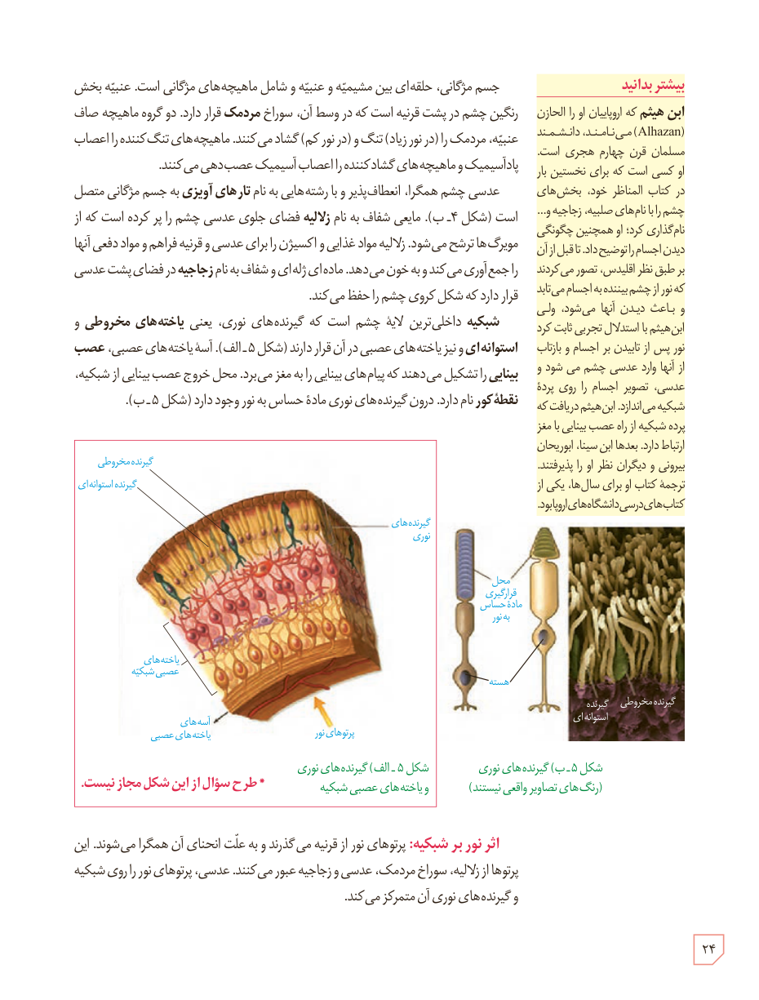

جسم مژگانی، حلقه‌ای بین مشیمیه و عنبیه و شامل ماهیچه‌های مژگانی است. عنبیه بخش رنگین چشم در پشت قرنیه است که در وسط آن، سوراخ **مردمک** قرار دارد. دو گروه ماهیچۀ صاف عنبیه، مردمک را (در نور زیاد) تنگ و (در نور کم) گشاد می‌کنند. ماهیچه‌های تنگ‌کنندۀ آن اعصاب پادآسیمپیک و ماهیچه‌های گشادکنندۀ آن اعصاب آسیمپیک عصب‌دهی می‌کنند.

عدسی چشم همگرا، انعطاف‌پذیر و با رشته‌هایی به نام **تارهای آویزی** به جسم مژگانی متصل است (شکل ۴ـ ب). مایعی شفاف به نام **زلالیه** فضای جلوی عدسی چشم را پر کرده است که از مویرگ‌ها ترشح می‌شود. زلالیه مواد غذایی و اکسیژن را برای عدسی و قرنیه فراهم و مواد دفعی آنها را جمع‌آوری می‌کند و به خون می‌دهد. ماده‌ای ژله‌ای و شفاف به نام **زجاجیه** در فضای پشت عدسی قرار دارد که شکل کروی چشم را حفظ می‌کند.

**شبکیه** داخلی‌ترین لایۀ چشم است که گیرنده‌های نوری، یعنی **یاخته‌های مخروطی و استوانه‌ای** و نیز یاخته‌های عصبی در آن قرار دارند (شکل ۵ـ الف). آسه یاخته‌های عصبی، **عصب بینایی** را تشکیل می‌دهند که پیام‌های بینایی را به مغز می‌برد. محل خروج عصب بینایی از شبکیه، **نقطۀ کور** نام دارد. درون گیرنده‌های نوری مادۀ حساس به نور وجود دارد (شکل ۵ـ ب).

**اثر نور بر شبکیه:** پرتوهای نور از قرنیه می‌گذرند و به علت انحنای آن همگرا می‌شوند. این پرتوها از زلالیه، سوراخ مردمک، عدسی و زجاجیه عبور می‌کنند. عدسی، پرتوهای نور را روی شبکیه و گیرنده‌های نوری آن متمرکز می‌کند.

### بیشتر بدانید: ابن هیثم

ابن هیثم که اروپاییان او را الهازن (Alhazan) می‌نامند، دانشمند مسلمان قرن چهارم هجری است. او کسی است که برای نخستین بار در کتاب المناظر خود، بخش‌های چشم را با نام‌های صلبیه، زجاجیه و... نام‌گذاری کرد؛ او همچنین چگونگی دیدن اجسام را توضیح داد. تا قبل از آن بر طبق نظر اقلیدس، تصور می‌کردند که نور از چشم بیننده به اجسام می‌تابد و باعث دیدن آنها می‌شود. ولی ابن هیثم با استدلال تجربی ثابت کرد نور پس از تابیدن بر اجسام و بازتاب از آنها وارد عدسی چشم می‌شود و عدسی، تصویر اجسام را روی پردۀ شبکیه می‌اندازد. ابن هیثم دریافت که پردۀ شبکیه از راه عصب بینایی با مغز ارتباط دارد. بعدها ابن سینا، ابوریحان بیرونی و دیگران نظر او را پذیرفتند. ترجمۀ کتاب او برای سال‌ها، یکی از کتاب‌های درسی دانشگاه‌های اروپا بود.

شکل ۵ـ الف) گیرنده‌های نوری و یاخته‌های عصبی شبکیه، ب) گیرنده‌های نوری (رنگ‌های تصاویر واقعی نیستند). * طرح سؤال از این شکل مجاز نیست.

۲۴

