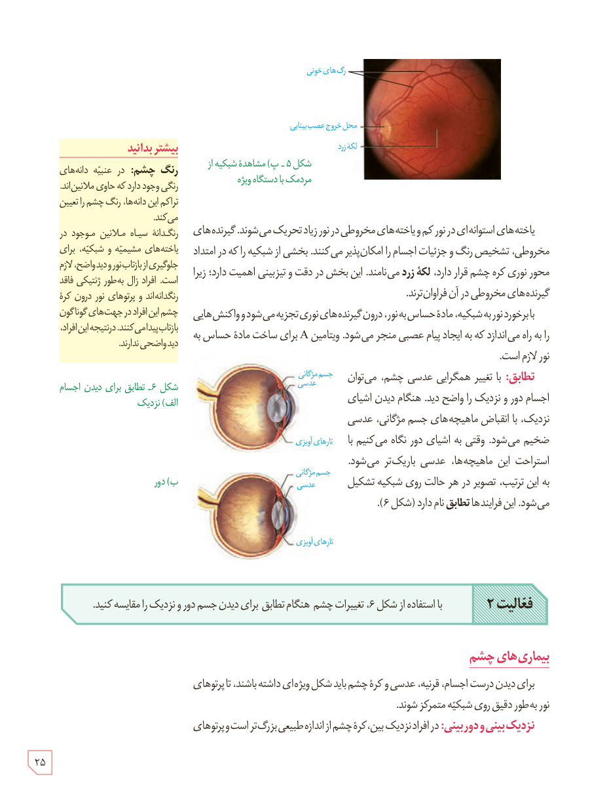

شکل ۵ـ پ) مشاهدۀ شبکیه از مردمک با دستگاه ویژه

یاخته‌های استوانه‌ای در نور کم و یاخته‌های مخروطی در نور زیاد تحریک می‌شوند. گیرنده‌های مخروطی، تشخیص رنگ و جزئیات اجسام را امکان‌پذیر می‌کنند. بخشی از شبکیه را که در امتداد محور نوری کرۀ چشم قرار دارد، **لکۀ زرد** می‌نامند. این بخش در دقت و تیزبینی اهمیت دارد؛ زیرا گیرنده‌های مخروطی در آن فراوان‌ترند.

با برخورد نور به شبکیه، مادۀ حساس به نور، درون گیرنده‌های نوری تجزیه می‌شود و واکنش‌هایی را به راه می‌اندازد که به ایجاد پیام عصبی منجر می‌شود. ویتامین A برای ساخت مادۀ حساس به نور لازم است.

**تطابق:** با تغییر همگرایی عدسی چشم، می‌توان اجسام دور و نزدیک را واضح دید. هنگام دیدن اشیای نزدیک، با انقباض ماهیچه‌های جسم مژگانی، عدسی ضخیم می‌شود. وقتی به اشیای دور نگاه می‌کنیم با استراحت این ماهیچه‌ها، عدسی باریک‌تر می‌شود. به این ترتیب، تصویر در هر حالت روی شبکیه تشکیل می‌شود. این فرایندها **تطابق** نام دارد (شکل ۶).

**فعالیت ۲:** با استفاده از شکل ۶، تغییرات چشم هنگام تطابق برای دیدن جسم دور و نزدیک را مقایسه کنید.

## بیماری‌های چشم

برای دیدن درست اجسام، قرنیه، عدسی و کرۀ چشم باید شکل ویژه‌ای داشته باشند، تا پرتوهای نور به‌طور دقیق روی شبکیه متمرکز شوند.

**نزدیک‌بینی و دوربینی:** در افراد نزدیک‌بین، کرۀ چشم از اندازۀ طبیعی بزرگ‌تر است و پرتوهای

### بیشتر بدانید: رنگ چشم

در عنبیه دانه‌های رنگی وجود دارد که حاوی ملانین‌اند. تراکم این دانه‌ها، رنگ چشم را تعیین می‌کند. رنگدانۀ سیاه ملانین موجود در یاخته‌های مشیمیه و شبکیه، برای جلوگیری از بازتاب نور و دید واضح، لازم است. افراد زال به‌طور ژنتیکی فاقد رنگدانه‌اند و پرتوهای نور درون کرۀ چشم این افراد در جهت‌های گوناگون بازتاب پیدا می‌کنند. در نتیجه این افراد، دید واضحی ندارند.

شکل ۶ـ تطابق برای دیدن اجسام: الف) نزدیک، ب) دور

۲۵

