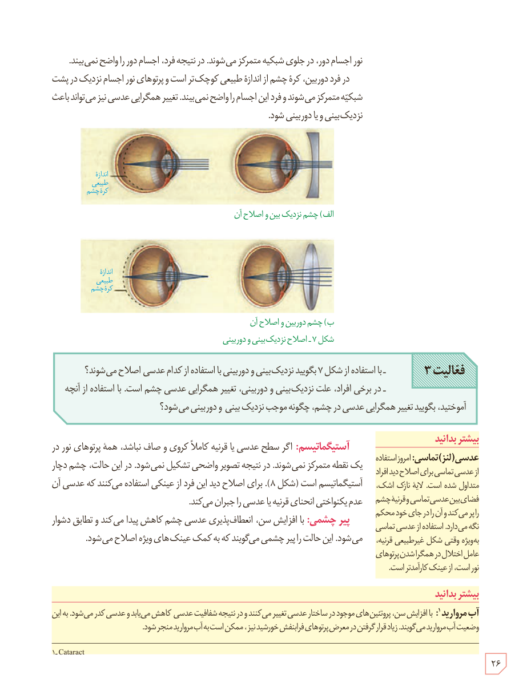

نور اجسام دور، در جلوی شبکیه متمرکز می‌شوند. در نتیجه فرد، اجسام دور را واضح نمی‌بیند. در فرد دوربین، کرۀ چشم از اندازۀ طبیعی کوچک‌تر است و پرتوهای نور اجسام نزدیک در پشت شبکیه متمرکز می‌شوند و فرد این اجسام را واضح نمی‌بیند. تغییر همگرایی عدسی نیز می‌تواند باعث نزدیک‌بینی و یا دوربینی شود.

شکل ۷ـ اصلاح نزدیک‌بینی و دوربینی: الف) چشم نزدیک‌بین و اصلاح آن، ب) چشم دوربین و اصلاح آن

**فعالیت ۳**

- با استفاده از شکل ۷ بگویید نزدیک‌بینی و دوربینی با استفاده از کدام عدسی اصلاح می‌شوند؟
- در برخی افراد، علت نزدیک‌بینی و دوربینی، تغییر همگرایی عدسی چشم است. با استفاده از آنچه آموختید، بگویید تغییر همگرایی عدسی در چشم، چگونه موجب نزدیک‌بینی و دوربینی می‌شود؟

**آستیگماتیسم:** اگر سطح عدسی یا قرنیه کاملاً کروی و صاف نباشد، همۀ پرتوهای نور در یک نقطه متمرکز نمی‌شوند. در نتیجه تصویر واضحی تشکیل نمی‌شود. در این حالت، چشم دچار آستیگماتیسم است (شکل ۸). برای اصلاح دید این فرد از عینکی استفاده می‌کنند که عدسی آن عدم یکنواختی انحنای قرنیه یا عدسی را جبران می‌کند.

**پیرچشمی:** با افزایش سن، انعطاف‌پذیری عدسی چشم کاهش پیدا می‌کند و تطابق دشوار می‌شود. این حالت را پیرچشمی می‌گویند که به کمک عینک‌های ویژه اصلاح می‌شود.

### بیشتر بدانید: عدسی (لنز) تماسی

امروز استفاده از عدسی تماسی برای اصلاح دید افراد متداول شده است. لایۀ نازک اشک، فضای بین عدسی تماسی و قرنیۀ چشم را پر می‌کند و آن را در جای خود محکم نگه می‌دارد. استفاده از عدسی تماسی بویژه وقتی شکل غیرطبیعی قرنیه، عامل اختلال در همگرا شدن پرتوهای نور است، از عینک کارآمدتر است.

### بیشتر بدانید: آب مروارید

با افزایش سن، پروتئین‌های موجود در ساختار عدسی تغییر می‌کنند و در نتیجه شفافیت عدسی کاهش می‌یابد و عدسی کدر می‌شود. به این وضعیت آب مروارید می‌گویند. زیاد قرار گرفتن در معرض پرتوهای فرابنفش خورشید نیز، ممکن است به آب مروارید منجر شود.

۱- Cataract

۲۶

