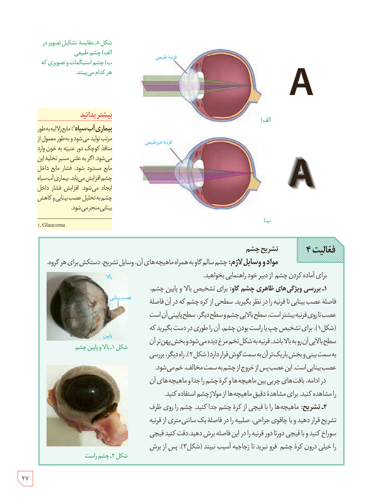

شکل ۸ـ مقایسۀ تشکیل تصویر در الف) چشم طبیعی، ب) چشم آستیگمات و تصویری که هر کدام می‌بینند.

### بیشتر بدانید: بیماری آب سیاه

مایع زلالیه به‌طور مرتب تولید می‌شود و به‌طور معمول از منافذ کوچک دور عنبیه به خون وارد می‌شود. اگر به علتی مسیر تخلیۀ این مایع مسدود شود، فشار مایع داخل چشم افزایش می‌یابد. بیماری آب سیاه ایجاد می‌شود. افزایش فشار داخل چشم به تحلیل عصب بینایی و کاهش بینایی منجر می‌شود.

۱- Glaucoma

## فعالیت ۴: تشریح چشم

**مواد و وسایل لازم:** چشم سالم گاو به همراه ماهیچه‌های آن، وسایل تشریح، دستکش برای هر گروه

برای آماده کردن چشم از دبیر خود راهنمایی بخواهید.

**۱- بررسی ویژگی‌های ظاهری چشم گاو:** برای تشخیص بالا و پایین چشم، فاصلۀ عصب بینایی تا قرنیه را در نظر بگیرید. سطحی از کرۀ چشم که در آن فاصلۀ عصب تا دور قرنیه بیشتر است، سطح بالایی چشم و سطح دیگر، سطح پایینی آن است (شکل ۱). برای تشخیص چپ یا راست بودن چشم، آن را طوری در دست بگیرید که سطح بالایی آن رو به بالا باشد. قرنیه به شکل تخم مرغ دیده می‌شود و بخش پهن‌تر آن به سمت بینی و بخش باریک‌تر آن به سمت گوش قرار دارد (شکل ۲). راه دیگر، بررسی عصب بینایی است. این عصب پس از خروج از چشم به سمت مخالف، خم می‌شود. در ادامه، بافت‌های چربی بین ماهیچه‌ها و کرۀ چشم را جدا و ماهیچه‌های آن را مشاهده کنید. برای مشاهدۀ دقیق ماهیچه‌ها از مولاژ چشم استفاده کنید.

**۲- تشریح:** ماهیچه‌ها را با قیچی از کرۀ چشم جدا کنید. چشم را روی ظرف تشریح قرار دهید و با چاقوی جراحی، صلبیه را در فاصلۀ یک سانتی‌متری از قرنیه سوراخ کنید و با قیچی دورتادور قرنیه را در این فاصله برش دهید. دقت کنید قیچی را خیلی درون کرۀ چشم فرو نبرید تا زجاجیه آسیب نبیند (شکل ۳). پس از برش

شکل ۱ـ بالا و پایین چشم  
شکل ۲ـ چشم راست

۲۷

