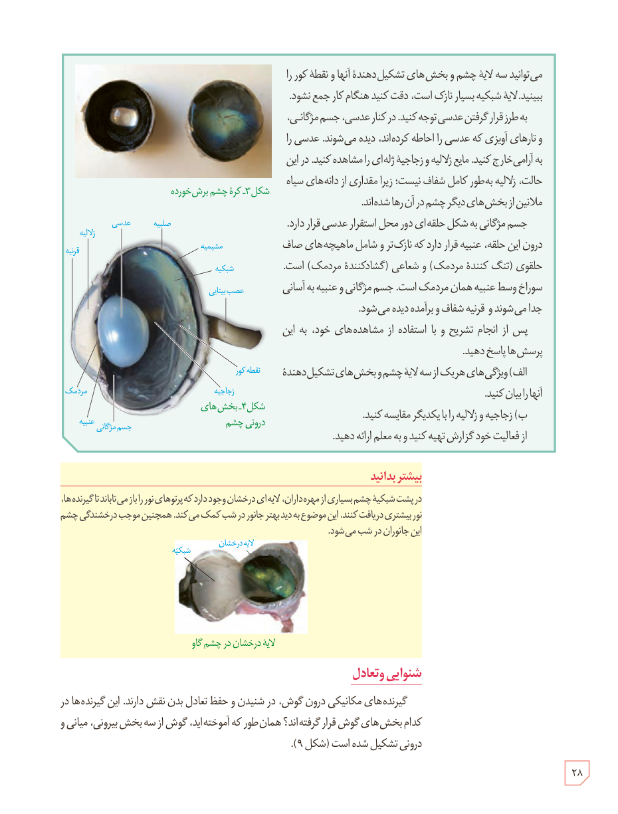

می‌توانید سه لایۀ چشم و بخش‌های تشکیل‌دهندۀ آنها و نقطۀ کور را ببینید. لایۀ شبکیه بسیار نازک است، دقت کنید هنگام کار جمع نشود.

به طرز قرار گرفتن عدسی توجه کنید. در کنار عدسی، جسم مژگانی، و تارهای آویزی که عدسی را احاطه کرده‌اند، دیده می‌شوند. عدسی را به آرامی خارج کنید. مایع زلالیه و زجاجیۀ ژله‌ای را مشاهده کنید. در این حالت، زلالیه به‌طور کامل شفاف نیست؛ زیرا مقداری از دانه‌های سیاه ملانین از بخش‌های دیگر چشم در آن رها شده‌اند.

جسم مژگانی به شکل حلقه‌ای دور محل استقرار عدسی قرار دارد. درون این حلقه، عنبیه قرار دارد که نازک‌تر و شامل ماهیچه‌های صاف حلقوی (تنگ‌کنندۀ مردمک) و شعاعی (گشادکنندۀ مردمک) است. سوراخ وسط عنبیه همان مردمک است. جسم مژگانی و عنبیه به آسانی جدا می‌شوند و قرنیۀ شفاف و برآمده دیده می‌شود.

پس از انجام تشریح و با استفاده از مشاهده‌های خود، به این پرسش‌ها پاسخ دهید.

الف) ویژگی‌های هر یک از سه لایۀ چشم و بخش‌های تشکیل‌دهندۀ آنها را بیان کنید.  
ب) زجاجیه و زلالیه را با یکدیگر مقایسه کنید.

از فعالیت خود گزارش تهیه کنید و به معلم ارائه دهید.

شکل ۳ـ کرۀ چشم برش خورده  
شکل ۴ـ بخش‌های درونی چشم

### بیشتر بدانید

در پشت شبکیۀ چشم بسیاری از مهره‌داران، لایه‌ای درخشان وجود دارد که پرتوهای نور را باز می‌تاباند تا گیرنده‌ها، نور بیشتری دریافت کنند. این موضوع به دید بهتر جانور در شب کمک می‌کند. همچنین موجب درخشندگی چشم این جانوران در شب می‌شود.

لایۀ درخشان در چشم گاو

## شنوایی و تعادل

گیرنده‌های مکانیکی درون گوش، در شنیدن و حفظ تعادل بدن نقش دارند. این گیرنده‌ها در کدام بخش‌های گوش قرار گرفته‌اند؟ همان‌طور که آموخته‌اید، گوش از سه بخش بیرونی، میانی و درونی تشکیل شده است (شکل ۹).

۲۸

