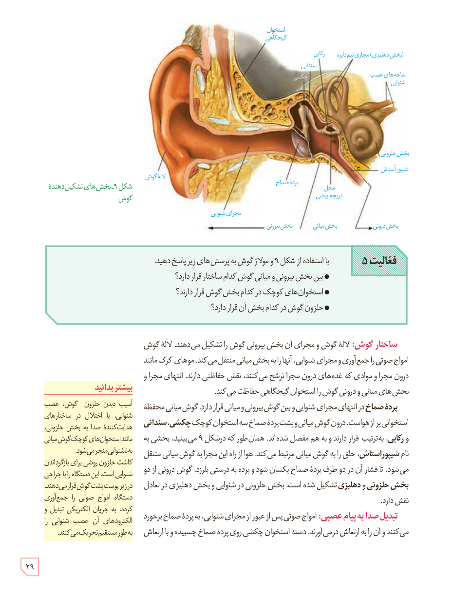

شکل ۹ـ بخش‌های تشکیل‌دهندۀ گوش

**فعالیت ۵:** با استفاده از شکل ۹ و مولاژ گوش به پرسش‌های زیر پاسخ دهید.

- بین بخش بیرونی و میانی گوش کدام ساختار قرار دارد؟
- استخوان‌های کوچک در کدام بخش گوش قرار دارند؟
- حلزون گوش در کدام بخش آن قرار دارد؟

**ساختار گوش:** لالۀ گوش و مجرای آن بخش بیرونی گوش را تشکیل می‌دهند. لالۀ گوش امواج صوتی را جمع‌آوری و مجرای شنوایی، آنها را به بخش میانی منتقل می‌کند. موهای کرک‌مانند درون مجرا و موادی که غده‌های درون مجرا ترشح می‌کنند، نقش حفاظتی دارند. انتهای مجرا و بخش‌های میانی و درونی گوش را استخوان گیجگاهی حفاظت می‌کند.

**پردۀ صماخ** در انتهای مجرای شنوایی و بین گوش بیرونی و میانی قرار دارد. گوش میانی محفظۀ استخوانی پر از هواست. درون گوش میانی و پشت پردۀ صماخ سه استخوان کوچک **چکشی، سندانی و رکابی**، به‌ترتیب قرار دارند و به هم مفصل شده‌اند. همان‌طور که در شکل ۹ می‌بینید، بخشی به نام **شیپور استاش**، حلق را به گوش میانی مرتبط می‌کند. هوا از راه این مجرا به گوش میانی منتقل می‌شود، تا فشار آن در دو طرف پردۀ صماخ یکسان شود و پرده به درستی بلرزد. گوش درونی از دو **بخش حلزونی و دهلیزی** تشکیل شده است. بخش حلزونی در شنوایی و بخش دهلیزی در تعادل نقش دارد.

**تبدیل صدا به پیام عصبی:** امواج صوتی پس از عبور از مجرای شنوایی، به پردۀ صماخ برخورد می‌کنند و آن را به ارتعاش درمی‌آورند. دستۀ استخوان چکشی روی پردۀ صماخ چسبیده و با ارتعاش

### بیشتر بدانید

آسیب دیدن حلزون گوش، عصب شنوایی، یا اختلال در ساختارهای هدایت‌کنندۀ صدا به بخش حلزونی، مانند استخوان‌های کوچک گوش میانی به ناشنوایی منجر می‌شود. کاشت حلزون روشی برای بازگرداندن شنوایی است. این دستگاه را با جراحی در زیر پوست پشت گوش قرار می‌دهند. دستگاه امواج صوتی را جمع‌آوری کرده، به جریان الکتریکی تبدیل و الکترودهای آن عصب شنوایی را به‌طور مستقیم تحریک می‌کنند.

۲۹

